# Skipa System Architecture Document

| | |
|---|---|
| Version | 1.0 (Checkpoint 3 draft for approval) |
| Date | 25 November 2026 |
| Inputs | PRD v2.0 (24 Nov 2026), PRD v1.0 (21 Nov 2026), Skipa design canvas (Claude Design, version 1795526158), product-owner decisions at Checkpoints 1–2 (24–25 Nov 2026) |
| Companion files | `api/openapi.v1.yaml` (API contract, OpenAPI 3.1, 177 operations); `db/schema.sql` (PostgreSQL 18 DDL, 80 tables + monthly event partitions) |
| Status | Draft — becomes the build baseline once approved |

**Precedence.** Where the PRD and the design canvas disagree, the **design canvas wins** (owner decision, 24 Nov), and its decisions log (Q01–Q25, D-10–D-24) is the latest word. Decisions made at the architecture checkpoints (listed in §1.3) override both and are written back into the PRD as v2.1 by product.

**How to read requirement IDs.** `SH-17` etc. are PRD IDs. `D-16`, `Q04` are design decisions. `AD-xx` are the architecture decisions made with the product owner at Checkpoints 1–2 (§1.3). `IR-xx` are inferred requirements (needed by the system but stated in neither PRD nor designs). `ADR-xx` are the decision records in §17.

---

## 1. Summary

### 1.1 The system in one page

Skipa lets shoppers in Nigerian supermarkets scan products on their own phone, pay through Paystack, and walk out through an express exit, while the store keeps control of losses, data and reconciliation. **Skipa facilitates; it never holds store money.** Each payment goes through Paystack on the store's own subaccount; Paystack settles the store's share to the store's bank and Skipa's platform fee to Skipa. Refunds are paid by the store outside Skipa and only *recorded* in Skipa.

Four web front ends sit on one versioned REST API:

| Surface | Users | Host | Notes |
|---|---|---|---|
| Shopper PWA | Guests, registered shoppers | `shop.skipa.ng` | Skipa home (Home, Stores, Support, Profile) + store-branded shopping; offline scanning after check-in; installable as "Skipa" |
| Exit mode | Exit checkers on a store phone/tablet | `exit.skipa.ng` | Online only (D-16); fixed Skipa result colours |
| Store dashboard | Store managers, head office admins | `stores.skipa.ng` | Live view, receipts, exit log, refunds, support inbox, catalogue, staff, settings, branding, reconciliation, analytics |
| Super admin | Skipa founding team | `admin.skipa.ng` | All stores, onboarding, transactions, errors, billing, configuration, audit |

Behind them: one **Fastify API** process and one **worker** process (same codebase), **PostgreSQL 18** doing data, job queue (pg-boss), real-time fan-out (LISTEN/NOTIFY) and full-text search, all on **one Hetzner server** for the pilot. Only the backend talks to Paystack, store POS systems, the SMS provider (shopper sign-in codes only), Resend (email) and the Telegram bot (platform alerts).

**Core flow:** QR check-in → cached catalogue → offline scanning → server price re-check → order → Paystack inline (redirect fallback) → webhook + verify → **Paid** → receipt with single-use 30-minute signed exit token → exit lookup (server decides clear/flagged/random) → **Exited** → stars, rating → POS sale posting → daily three-way reconciliation (receipt ↔ POS ↔ Paystack settlement).

**Where correctness matters most (and how it is guaranteed):**

| Area | Guarantee | Mechanism |
|---|---|---|
| Payment → receipt | Never a receipt without Paystack confirmation; never two | Server-side verify on webhook and polling; amount/currency/reference/subaccount must match; `one_successful_attempt_per_order` unique index; state transition in one transaction with `SELECT … FOR UPDATE` |
| Retries | No double charge, no double order | `Idempotency-Key` on every money-moving POST; idempotency table; unique Paystack reference per attempt; webhook de-dupe key |
| Exit | Receipt cleared once, only at its branch, only within 30 min, only when paid | Signed token (Ed25519) carries only `jti`; server checks and consumes `exit_token_used_at` atomically; random check decided at Paid time on the server (`exit_plans`) |
| POS posting | Every sale posted exactly once in effect | Posting row created in the same transaction as Paid (outbox); idempotency key `sale:<orderId>` sent to the POS; retries with backoff; reconciliation catches gaps |
| Reconciliation | Every order matched daily or listed with a cause | Nightly job at 02:00 WAT + on settlement arrival; `reconciliation_items` with cause codes |
| History | Financial history never overwritten | Append-only triggers on order items, status histories, ledgers, audit; corrections are new rows |

### 1.2 Approved stack

| Layer | Choice (version) | Pilot cost/month |
|---|---|---|
| Language, repo | TypeScript 7.0.2 on Node.js 24 LTS; pnpm 12.23 workspaces; Turborepo 2.11 | $0 |
| API | Fastify 5.12.8 + fastify-type-provider-zod 7.0.0 + Zod 4.6.7; REST `/v1`; OpenAPI 3.1 via @fastify/swagger 9.9.5 | $0 |
| Database | PostgreSQL 18.7 (self-hosted, Docker); Drizzle ORM 0.45.4 / drizzle-kit 0.31.11; node-postgres 8.23.1 | in server |
| Jobs | pg-boss 12.39.0 (queue inside Postgres) | $0 |
| Real-time | Server-sent events + Postgres LISTEN/NOTIFY; polling fallback | $0 |
| Web apps | React 19.3.1, Vite 8.3.8, TanStack Router 1.170.46, TanStack Query 5.108.4, react-hook-form 7.92.0 | $0 |
| PWA/offline | vite-plugin-pwa 2.0.0 (Workbox 7.4), Dexie 4.4.7 (IndexedDB) | $0 |
| Scanner | Native BarcodeDetector + barcode-detector 3.2.4 polyfill (zxing-wasm 3.1.7) | $0 |
| UI | `tokens.css` v1.1 → Tailwind CSS 4.3.5 `@theme`; Radix Primitives; Recharts 3.11.1 (dashboards only) | $0 |
| Auth | In-house one-time codes + opaque sessions (@oslojs/crypto 1.0.1); TOTP (otplib 13.6.0) behind flag | $0 |
| Hosting | Hetzner Cloud CPX32 (4 vCPU/8 GB/160 GB), Helsinki; Docker Compose; Caddy 2.11.9 | €30.49 |
| Edge | Cloudflare Free (DNS, TLS, DDoS, WAF); Workers static assets for the 4 web apps | $0 |
| Storage & backups | Cloudflare R2; pgBackRest (WAL every 60 s, encrypted) | ~$0.20 |
| SMS | Africa's Talking (primary), Termii (failover) — **shopper sign-in codes only** | ~$5.61 |
| Email | Resend Free (3,000/month, 100/day) with a daily reserve for codes and alerts | $0 |
| Alerts | Telegram bot (platform), in-app alert centres, email fallback | $0 |
| Analytics | Own `analytics.events` table (source of truth) + capped forward to PostHog Cloud EU | $0 |
| Errors | Sentry SDK 11.17.0 → self-hosted GlitchTip 7.0 | $0 |
| Logs/metrics | Pino 10.4.0 → Grafana Alloy 1.22 → Loki 3.7.10; Prometheus 3.16; Grafana 13.2 | $0 |
| Uptime | Uptime Kuma 2.5.12 on Melbicom Lagos VDS-1 | €5.70 |
| Secrets | SOPS + age (encrypted env files in git) | $0 |
| CI/CD | GitHub Actions + GitHub Container Registry | $0 |
| Tests | Vitest 5.1.1, Playwright 1.65.1, k6, MSW 3.0.7 | $0 |
| Phase 3 mobile | Expo (SDK 58 today) / React Native 0.88 | later |

### 1.3 Monthly cost (USD; ₦1,390/$; €1 = $1.09; excl. VAT)

| | Pilot (2 stores) | 20 stores | 100 stores |
|---|---|---|---|
| Servers (+ load balancer at 100) | $33.23 | $83.36 | $251.18 |
| Lagos watchdog | $6.21 | $6.21 | $6.21 |
| SMS — shopper sign-in codes | $5.61 | $84.17 | $388.49 |
| Email (Resend) | $0 | $20 | $90 |
| R2, Cloudflare plan, PostHog, domain | ~$2.20 | ~$5 | ~$87 |
| **Total** | **≈ $47 (₦66,000)** | **≈ $199 (₦276,000)** | **≈ $823 (₦1.14M)** |

Paystack fees are paid by stores (bearer = subaccount) and are not a Skipa cost. Line-by-line detail and sources: §14.

### 1.4 Decisions made at the architecture checkpoints (AD-xx)

| ID | Decision (owner, 24–25 Nov 2026) | Changes |
|---|---|---|
| AD-01 | Design canvas takes precedence over the PRD | Precedence rule |
| AD-02 | Receipts: always in the app; emailed automatically only to shoppers who opt in ("Email my receipts"), otherwise one tap. No SMS receipts | SH-21, 05.2 |
| AD-03 | SMS only for shopper sign-in codes (registration, "I've used Skipa before") | NT-05, 9 |
| AD-04 | Exit checkers sign in with **email** codes; all staff invites by email | RB-02, RB-06, D-17, Q24 |
| AD-05 | Super admin alerts: in-app alert centre + Telegram; email only when both are unavailable. Store alerts: dashboard + email, never SMS | 9, 14.4 |
| AD-06 | Store pays Paystack fees (`bearer: "subaccount"`); Skipa takes only its platform fee via the split (default 2%, pilot 0%) | PY-12, PY-13, 8.4 |
| AD-07 | Refunds happen outside Skipa: shopper requests, store approves (head office above ₦20,000), store pays the shopper itself, a manager **records** the payment | PY-07, PY-10, SH-32 |
| AD-08 | Skipa's fee is **not** reversed on refunded orders | PY-12, SA-08 |
| AD-09 | Skipa holds a chargeback reserve; lost chargebacks on store sales are recorded as store receivables | PY-09, 8.4 |
| AD-10 | Guests messaging support give an optional email instead of a phone number | HP-09 |
| AD-11 | Opera Mini shows "Open in Chrome" rather than a degraded app | NF-21 |
| AD-12 | Size for the pilot; keep a written scaling path (§15) rather than provisioning for 10,000 concurrent shoppers on day one | 16.1 |
| AD-13 | Budget hosting that works well (Hetzner shared vCPU, single server at pilot); hosting in Nigeria is not a requirement | NF-19 |
| AD-14 | Email stays on Resend's free plan for now | NT-06 |
| AD-15 | Fastify, not NestJS | ADR-02 |

---

## 2. Context and constraints

### 2.1 Users and roles

| Role | Signs in with | Session | Scope |
|---|---|---|---|
| Guest shopper | Nothing; device token | Device | Own device's orders |
| Registered shopper | Phone + SMS code | Long-lived on the device (90 days idle, sliding) | Own data across stores |
| Exit checker | Work or personal **email** + emailed code (AD-04) | 12 h idle, ended by "Hand over" (RB-06, design) | Own branch, exit mode only |
| Store manager | Email + emailed code | 8 h idle (configurable, 3.1) | Assigned branches |
| Head office admin | Email + emailed code | 8 h idle | Whole organisation |
| Super admin | Email + emailed code; TOTP when flag on (D-23) | 30 min idle (SA-01) | Everything; personal data behind a reason gate |
| Support agent (later) | As super admin | 30 min idle | Read-only, personal data masked |

### 2.2 External integrations

| System | Direction | Used for | Contract |
|---|---|---|---|
| Paystack | Out (REST) + in (webhooks) | Initialise on subaccount, verify, disputes + evidence, subaccounts, settlements | §6.6 |
| Store POS | Out/in (per connector) or files | Prices, stock, departments; sale/refund/chargeback postings to the "Skipa" till; shift-close | §6.7 |
| Africa's Talking / Termii | Out + delivery-report webhooks | Shopper sign-in codes only | §6.9 |
| Resend | Out + webhooks | Staff and admin sign-in codes, invites, receipts, store alerts, daily summary, weekly loss report, support replies | §6.9 |
| Telegram Bot API | Out | Platform alerts to the Skipa team group | §10.5 |
| Cloudflare | Edge | DNS, TLS, WAF, DDoS, static hosting, R2 | §12 |
| PostHog Cloud (EU) | Out | Funnels/retention from a capped event forward (internal IDs only) | §9 |
| GlitchTip (self-hosted) | In from SDKs via API tunnel | Error tracking | §10 |
| Browser APIs | — | Camera, BarcodeDetector, geolocation (on the phone only), Web Share, service worker | §8 |

No maps provider is needed: store search shows a list with distances computed on the phone (SH-26, NF-29).

### 2.3 Non-functional targets (drivers)

| Target | Value | Where addressed |
|---|---|---|
| First load (3G) | < 4 s; < 1.5 s cached; < 500 KB excluding product list | §8.5 |
| Scan → item in cart | < 1 s (offline, from IndexedDB) | §8.4 |
| Paystack confirmation → receipt | < 5 s | §6.6, SSE |
| Exit lookup | < 2 s on 3G | §6.5, §12 |
| API | p95 < 500 ms | §10, §13 load tests |
| Dashboard live updates | ≤ 5 s | §6.10 |
| Store search | < 2 s on 3G | branch list cached on device |
| Concurrency | 500/branch, 10,000 platform-wide (proved by load test and scaling path, AD-12) | §13.6, §15 |
| Availability | 99.9% in opening hours for shopper app, payments, exit | §12.7 |
| Backups | RPO 15 min (achieved ≈1 min), RTO 1 h | §12.6 |
| Offline | Scanning after check-in; exit online only | §8.4, §8.6 |
| Security | HTTPS, encryption at rest, no card data, signed webhooks, rate limits, pen test before go-live | §11 |
| Privacy | NDPA: store = controller, Skipa = processor (Skipa controller for Skipa home, search, account) | §11.6 |
| Mobile readiness | All logic behind `/v1`; old clients supported ≥ 6 months | §6.2, §15 |

### 2.4 Budget and team

One or two engineers plus AI coding agents. Every component must be justified against "can Postgres or the existing server do this yet?" Cost ranks first after security and correctness of money handling.

### 2.5 Data protection position (needs legal confirmation)

Shopper personal data is stored in Hetzner's Helsinki data centre (EU). Under NDPA 2023 ss. 41–43 and GAID 2025, a transfer out of Nigeria needs a lawful basis (adequacy decision, approved transfer instrument such as standard contractual clauses, or a listed derogation) plus a transfer impact assessment and records. Required before go-live: Hetzner GDPR DPA; Skipa ↔ store data processing agreement with SCC-style transfer clauses; DPIA covering Hetzner, Cloudflare (proxy transit and R2 backups), Resend (email addresses), Africa's Talking/Termii (phone numbers), PostHog EU (pseudonymous IDs) and GlitchTip (self-hosted, scrubbed). **Mark: legal confirmation required (NF-19).**

---

## 3. Architecture overview

### 3.1 System context

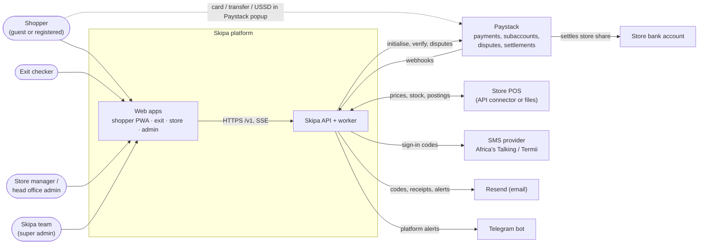

### 3.2 Containers

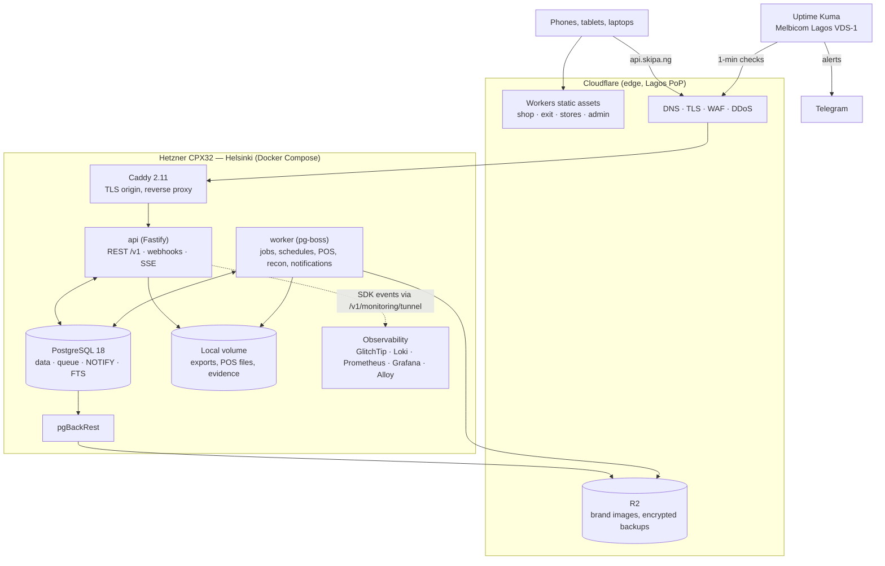

**What runs where**

| Container | Image | Purpose | Scales by |
|---|---|---|---|
| `caddy` | caddy:2.11.9 | TLS with Cloudflare origin certificate, reverse proxy, request size limits, gzip | Single |
| `api` | `ghcr.io/skipa/api:<sha>` | HTTP API, webhooks, SSE | More replicas (stateless) behind Caddy / LB |
| `worker` | same image, `node dist/worker.js` | pg-boss consumers + cron schedules | More replicas (pg-boss uses `SKIP LOCKED`) |
| `postgres` | postgres:18.7 | All state | Bigger server → replica → dedicated DB server |
| `glitchtip` | glitchtip/glitchtip:7.0.0 (all-in-one) | Error tracking | Single |
| `loki`, `alloy`, `prometheus`, `grafana`, `node-exporter`, `postgres-exporter` | grafana/loki:3.7.10, grafana/alloy:v1.22.0, prom/prometheus:v3.16.0, grafana/grafana:13.2.7 | Logs, metrics, dashboards, alert rules | Move to ops server at 20 stores |
| `pgbackrest` | sidecar (pgBackRest 2.x from Debian packages) | WAL archive + backups to R2 | — |
| Uptime Kuma | louislam/uptime-kuma:2.5.12 on a separate provider | External checks, Telegram alerts | — |

### 3.3 How the pieces connect

- The four web apps are static bundles served from Cloudflare. They call `https://api.skipa.ng/v1` with `credentials: 'include'` (httpOnly cookie, same-site) and receive server-sent events from `/v1/stream`.
- The API is the only writer to Postgres for request work. Long or retryable work is enqueued **in the same transaction** as the state change (pg-boss `send` with the transaction's client), so a crash can never lose a POS posting, receipt email or exit plan.
- The worker runs every scheduled and queued job (§6.8). It also listens to Postgres `NOTIFY` for nothing user-facing — real-time fan-out is done by each API process listening on `skipa_events` and pushing to its own SSE connections.
- Observability containers are bound to the private Docker network and reached by engineers through an SSH tunnel; nothing operational is exposed publicly except `/health/live`.

### 3.4 How Phase 3 native apps slot in

The native apps (Expo) are a fifth client of the same `/v1` API: they use `Authorization: Bearer` instead of the cookie, the same generated client (`packages/api-client`), the same Zod contracts, the same token package (via its TypeScript export) and the same analytics event names (AN-04). Push notifications become one more notification channel in the notifications module; the wallet (WL-01–10) becomes a payment-method module that the order state machine already supports through `payment_attempts.channel_requested`. Details in §15.

---

## 4. Technology stack

Costs are monthly at pilot / 20 stores / 100 stores. "ADR" links to §17. Versions were checked on npm, Docker Hub and vendor pages on 24–25 Nov 2026; pin exact versions in `package.json` / `compose.yaml` and update deliberately (Renovate, weekly).

| Technology | Version | Purpose | Why chosen | Alternative | Switch trigger | Cost P / 20 / 100 | ADR |
|---|---|---|---|---|---|---|---|
| TypeScript | 7.0.2 | One language for API, web, mobile | Shared types and Zod contracts | TypeScript 6.x | Any tool in the chain fails on TS 7 → pin 6.x for that package | $0 | ADR-01 |
| Node.js | 24 LTS | Runtime | Maintenance LTS, native modules (argon2) supported | Node 26 LTS | 3 months after Node 26 LTS with all deps green | $0 | ADR-01 |
| pnpm / Turborepo | 12.23 / 2.11 | Monorepo, task caching | Fast, strict workspaces | npm workspaces + Nx | Build graph > 40 packages | $0 | ADR-01 |
| Fastify | 5.12.8 | HTTP API | Schema-first with Zod, `inject()` tests, small surface | NestJS | Backend team > 5 engineers, or hires are Nest-only | $0 | ADR-02 |
| Zod + fastify-type-provider-zod | 4.6.7 / 7.0.0 | Validation and contract | One schema for API, forms, OpenAPI, native | TypeBox | — | $0 | ADR-03 |
| @fastify/swagger | 9.9.5 | Generates OpenAPI 3.1 from routes | Contract stays in sync with code | Hand-written OpenAPI | — | $0 | ADR-03 |
| openapi-typescript / openapi-fetch | 7.13.0 / 0.17.0 | Typed client for web and native | Zero-runtime-cost types | Orval | — | $0 | ADR-03 |
| PostgreSQL | 18.7 | All state, queue, NOTIFY, FTS | One component for many jobs; strong consistency | Managed Postgres (Neon $0.106/CU-h; DO from $15.15) | Ops > 4 h/month or HA automation needed at 100 stores | in server | ADR-04 |
| Drizzle ORM / drizzle-kit | 0.45.4 / 0.31.11 | Typed queries, SQL migrations | SQL-shaped, raw SQL easy, no engine | Kysely | A Drizzle release breaks migrations | $0 | ADR-05 |
| node-postgres (`pg`) | 8.23.1 | Driver | Stable; LISTEN/NOTIFY support | postgres.js | — | $0 | ADR-05 |
| pg-boss | 12.39.0 | Jobs, cron, retries | Enqueue in the same transaction as state change | Graphile Worker; BullMQ + Redis | > 500 jobs/s sustained or queue > 20% DB load | $0 | ADR-06 |
| SSE + LISTEN/NOTIFY | — | Live updates | Plain HTTP; Cloudflare-friendly; RN via `react-native-sse` | ws/Socket.IO; Centrifugo | > 10k connections/node or need for two-way | $0 | ADR-07 |
| React | 19.3.1 | All web UIs | Shared UI package across 4 apps and later RN mental model | Preact 11 (`preact/compat`) | Shopper entry JS > 170 KB gz or TTI > 5 s on reference phone | $0 | ADR-08 |
| Vite | 8.3.8 | Build/dev server | Fast, simple SPA/PWA builds | Rspack | — | $0 | ADR-08 |
| TanStack Router / Query | 1.170.46 / 5.108.4 | Routing, server state | Type-safe routes; caching, retries, offline persistence | React Router + SWR | — | $0 | ADR-09 |
| react-hook-form | 7.92.0 | Forms (dashboards) | Small, uncontrolled, Zod resolver | TanStack Form | — | $0 | ADR-09 |
| vite-plugin-pwa (Workbox) | 2.0.0 (7.4.1) | Service worker | Precache + runtime caching with tested strategies | Hand-written SW | — | $0 | ADR-11 |
| Dexie | 4.4.7 | IndexedDB | Indexed catalogue lookups, outbox | idb | — | $0 | ADR-11 |
| barcode-detector (zxing-wasm) | 3.2.4 (3.1.7) | Scanning | Native where available, WASM fallback (iOS) | Scanbot/Scandit (quote-based) | < 95% first-try scans on reference devices | $0 | ADR-10 |
| Tailwind CSS | 4.3.5 | Styling | `@theme` maps 1:1 to `tokens.css` CSS variables | CSS modules | — | $0 | ADR-12 |
| Radix Primitives | latest 1.x | Accessible headless widgets (dialog, popover, tabs, switch) | ARIA and focus handled | Ark UI | — | $0 | ADR-12 |
| Recharts | 3.11.1 | Dashboard charts (lazy) | React API, enough for our charts | uPlot | > 10k points/chart | $0 | ADR-13 |
| @oslojs/crypto, otplib | 1.0.1 / 13.6.0 | Token hashing, TOTP (flag) | Minimal audited primitives | Clerk ($25 + SMS) | Auth incidents or SSO need | $0 | ADR-14 |
| Hetzner Cloud | CPX32 → +CPX22 → CPX52/42/32 + LB11 | Compute | Good price, 99.9% SLA, snapshots, LB, API | Melbicom Lagos (cheaper, no backups) | p95 from Lagos > 800 ms or SLA missed twice/quarter | $33.23 / $83.36 / $251.18 | ADR-15 |
| Docker Compose + Caddy | Compose v2, Caddy 2.11.9 | Run and proxy | Simple, reproducible | Kamal; k3s | > 4 servers | $0 | ADR-15 |
| Ansible | 2.x (ansible-core) | Server provisioning | Rebuild a server from scratch in < 20 min | Terraform + cloud-init | — | $0 | ADR-15 |
| Cloudflare (Free) | — | DNS, TLS, WAF, DDoS, static assets | Free, Lagos PoP | Vercel/Netlify | Need WAF rules beyond free → Pro $25 | $0 / $0 / $25 | ADR-16 |
| Cloudflare R2 | — | Brand images, encrypted backups, exports archive | $0.015/GB, free egress, 10 GB free | Backblaze B2 ($6.95/TB) | > 2 TB stored | ~$0.20 / $3 / $10 | ADR-17 |
| pgBackRest | 2.x | Backups + PITR | Encryption, retention, verified restores | WAL-G | — | $0 | ADR-18 |
| Africa's Talking + Termii | API | Shopper sign-in SMS with failover | Published ₦5.50–6.00/SMS; DND-capable | Termii-only if quote ≤ ₦6.50 | Delivery < 95% or price change | $5.61 / $84.17 / $388.49 | ADR-19 |
| Resend | Free → Pro → Scale | Transactional email | Free 3,000/mo; good DX | Amazon SES ($0.10/1,000) | > 50k/month or Scale overage → SES | $0 / $20 / $90 | ADR-20 |
| Telegram Bot API | — | Platform alerts | Free, phones already have it | Slack | — | $0 | ADR-21 |
| PostHog Cloud EU | posthog-node/HTTP capture | Funnels, retention (capped forward) | 1M events free | Metabase on own events | Bill would exceed $50 or legal objects | $0 / $0 / ≤$50 | ADR-22 |
| Sentry SDKs → GlitchTip | @sentry/* 11.17.0 → GlitchTip 7.0 | Errors with request IDs, releases | Free, data stays on our server, Sentry-compatible | Sentry Team $26 | Need tracing/replay or > 2 h/month upkeep | $0 | ADR-23 |
| Pino / Alloy / Loki / Prometheus / Grafana | 10.4.0 / 1.22.0 / 3.7.10 / 3.16.0 / 13.2.7 | Logs (90 days), metrics, alert rules | Free; meets ER-04 retention | Grafana Cloud Pro (from $19) | Upkeep > 2 h/month | $0 | ADR-24 |
| Uptime Kuma | 2.5.12 on Melbicom Lagos VDS-1 | External uptime, Telegram + email | Other provider, measures from Lagos | Better Stack Free | — | $6.21 | ADR-24 |
| SOPS + age | 3.x / 1.x | Secrets in git, encrypted | No extra service | Infisical self-hosted | > 3 people need prod secrets, or audit trail needed | $0 | ADR-25 |
| GitHub Actions + GHCR | — | CI/CD, images | $12 free compute/month | Self-hosted runner | Minutes exhausted | $0 | ADR-26 |
| Vitest / Playwright / k6 / MSW | 5.1.1 / 1.65.1 / latest / 3.0.7 | Tests and mocks | Fast, standard | Jest/Cypress | — | $0 | ADR-27 |
| Expo / React Native | SDK 58 / 0.88 (today) | Phase 3 apps | Reuses contracts, client, tokens | Flutter | — | $0 (EAS free) | ADR-28 |

---

## 5. Repository and code structure

### 5.1 Monorepo layout (`github.com/<org>/skipa`, private)

```
skipa/
├─ apps/
│  ├─ api/                 Fastify server (src/server.ts) + worker (src/worker.ts)
│  │  ├─ src/modules/<module>/   routes.ts · service.ts · repo.ts · jobs.ts · events.ts · *.test.ts
│  │  ├─ src/platform/      db, auth, idempotency, errors, logger, realtime, queue, config, rls
│  │  └─ src/integrations/  paystack/, pos/, sms/, email/, telegram/, posthog/, storage/
│  ├─ shopper/             React PWA (shop.skipa.ng)
│  ├─ exit/                React app (exit.skipa.ng)
│  ├─ store/               React SPA (stores.skipa.ng)
│  └─ admin/               React SPA (admin.skipa.ng)
├─ packages/
│  ├─ contracts/           Zod schemas + error codes + event names (source of OpenAPI)
│  ├─ api-client/          openapi-fetch client generated from api/openapi.v1.yaml
│  ├─ tokens/              tokens.css (from Claude Design) → CSS vars, Tailwind theme, TS object
│  ├─ ui/                  shared React components (Button, Field, StatusChip, Table, Sheet, Tour…)
│  ├─ domain/              pure TS: money (kobo), flagging rules, fee maths, state machines, WAT dates
│  ├─ analytics/           typed tracking plan + client (batching, outbox)
│  ├─ mocks/               MSW handlers + fixtures matching the OpenAPI file
│  └─ config/              eslint, tsconfig, vitest presets
├─ api/openapi.v1.yaml     the contract (§6.2)
├─ db/                     migrations (drizzle), seed/, schema.sql snapshot
├─ infra/                  ansible/, compose/, caddy/, grafana/, alloy/, pgbackrest/, kuma/
├─ e2e/                    Playwright tests (shopper, exit, store, admin), k6/
├─ docs/                   this document, ADRs, runbooks, metric dictionary, tracking plan
└─ .github/workflows/      ci.yml, deploy-staging.yml, deploy-prod.yml, nightly.yml
```

**Module template (backend).** Every module under `apps/api/src/modules/` has the same files: `routes.ts` (Fastify plugin; validation only, no business logic), `service.ts` (business logic; plain classes, no Fastify imports, takes a `Tx` and repositories), `repo.ts` (Drizzle queries; only file allowed to touch tables), `jobs.ts` (pg-boss handlers), `events.ts` (domain events published to realtime/analytics). Lint rule `no-restricted-imports` forbids `service.ts` importing Fastify and forbids any module except `identity` importing `pii` tables.

### 5.2 Naming

| Thing | Convention | Example |
|---|---|---|
| Tables, columns | snake_case, plural tables | `payment_attempts.paystack_fees_kobo` |
| Money fields | suffix `_kobo` (DB) / `Kobo` (API) | `totalKobo` |
| API paths | kebab-case nouns, `/v1` prefix | `/v1/store/refunds/{refundId}/payment` |
| JSON | camelCase | `exitValidUntil` |
| Jobs | `module.action` | `payments.verify` |
| Events | `object_action` past tense | `receipt_issued` |
| Error codes | `PREFIX-NNN` | `PAY-007` |
| Env vars | SCREAMING_SNAKE with prefix | `PAYSTACK_SECRET_KEY` |
| Feature flags | snake_case | `superadmin_second_step` |
| Branches | `feat/<ticket>-short`, `fix/…`, `chore/…` | `feat/SKP-41-exit-lookup` |

### 5.3 Branching, commits, reviews

- Trunk-based: `main` is always deployable; short-lived branches; squash merge.
- Conventional Commits (`feat(payments): verify on webhook`), enforced by commitlint; release notes generated from them.
- Every PR: CI green, one human review (AI-authored PRs always need a human approval), PRD IDs in the description. PRs touching `api/openapi.v1.yaml` carry the label `contract-change` and need sign-off from the other side (frontend or backend).
- Money-path files (`modules/payments`, `modules/exit`, `modules/refunds`, `modules/recon`, `integrations/paystack`) are in `CODEOWNERS` and require the lead's review.

### 5.4 Code style

ESLint (typescript-eslint strict) + Prettier; `strict: true`, `noUncheckedIndexedAccess: true`; no `any` in `packages/domain`; money only through `packages/domain/money.ts` (`Kobo` branded integer type, `formatNaira(kobo)` — "₦31,300", kobo shown only when non-zero, DM-01); dates only through `packages/domain/time.ts` (WAT via `Intl.DateTimeFormat('en-NG', { timeZone: 'Africa/Lagos' })`).

---

## 6. Backend design

### 6.1 Modules mapped to the PRD

| Module (`apps/api/src/modules/…`) | PRD sections / IDs | Owns tables | Key jobs |
|---|---|---|---|
| `identity` (auth, devices, shoppers, staff, invites, sessions) | 3, RB-01–07, SH-05–08, SA-01, NF-11, NF-27, NF-28 | users, user_branches, staff_invites, devices, otp_challenges, sessions, known_admin_devices, pii.* | invites.expire, admin.new_device_notice |
| `tenancy` (organisations, branches, settings, plans, flags) | CS-06, CS-07, SA-04, SA-05, SA-09, SD-03, EX-11 | organisations, branches, branch_settings, qr_codes, feature_flags, platform_settings | — |
| `catalogue` | 7, CT-01–09, PO-01, PO-02, PO-10, SH-09–13 | standard_categories, categories, branch_categories, pos_department_mappings, products, branch_products, product_price_history, catalogue_snapshots, loss_baselines, loss_counts | catalogue.rebuild_snapshot, catalogue.stale_price_check |
| `shopping` (check-in, sessions, cart quotes) | 5.3, 5.5, 5.8, SH-01–03, SH-14–16, SH-25 | shopping_sessions, unknown_barcodes | sessions.timeout |
| `payments` (orders, attempts, Paystack) | 8, PY-01–06, PY-11, PY-12, CS-01–03, NF-05 | orders, order_items, order_status_history, payment_attempts, paystack_events, stray_charges | payments.verify, payments.process_webhook, payments.sweep_pending |
| `receipts` | SH-18–24, PY-06 | receipts, receipt_deliveries | receipts.email |
| `exit` | 6, EX-01–12, NF-26 | exit_plans, random_check_blocks, exit_devices, exit_checks, exit_check_items, checker_signals | exit.heartbeat_monitor, exit.abandon_open_checks, exit.checker_signals |
| `refunds` (recorded, off-platform — AD-07) | SH-22, SH-32, PY-07, PY-08, PY-10 | refunds, refund_status_history | refunds.record_reminder |
| `disputes` | PY-09, AD-09 | disputes, chargeback_reserve_ledger, financial_adjustments | disputes.respond, disputes.deadline_watch |
| `pos` (connector framework) | 12, PO-01–10 | pos_connections, pos_sync_runs, pos_files, pos_postings | pos.pull_catalogue, pos.import_file, pos.post, pos.build_daily_files |
| `recon` (reconciliation, payouts, billing) | 12.2, PO-07, PO-08, PY-13, SA-08 | paystack_settlements, settlement_lines, reconciliation_runs, reconciliation_items, payout_reports, billing_statements | recon.fetch_settlements, recon.daily, recon.billing_monthly |
| `notifications` (email, SMS, Telegram, in-app alerts) | 9, NT-01–06, 14.4 | notifications, notification_templates, notification_preferences, alerts | notifications.send_*, notifications.email_budget_release, alerts.digest |
| `support` (tickets, chatbot) | 9.2, HP-01–15, SH-27 | support_tickets, support_messages, faqs, faq_synonyms, pii.contact_details | support.sla_watch |
| `stars` | 5.10, ST-01–10 | star_rules, star_ledger | stars.award, stars.reverse |
| `branding` | 10.3, BR-01–11 | branding_versions | branding.process_asset |
| `analytics` (ingest, reports, PostHog forward) | 13, AN-01–11, 2.4 | analytics.events | analytics.forward_posthog, analytics.partitions_maintain, reports.daily_summary, reports.weekly_loss |
| `audit` (audit log, reason gate, view-as) | RB-04, RB-05, RB-07, SA-03, SA-07, SD-20 | audit.* | — |
| `privacy` (data requests, retention, offboarding) | NF-13–19, NF-29, DM-05, DM-06 | pii.data_requests | privacy.process_requests, privacy.retention_purge, privacy.store_offboarding |
| `exports` | SD-05, SA-07 | exports | exports.build |
| `monitoring` (error index, health, tunnel) | 14, ER-01–12 | error_events | — |
| `tours` | SH-31, SD-21, EX-12 | tour_progress | — |

### 6.2 API design

**Contract.** `api/openapi.v1.yaml` (OpenAPI 3.1, 177 operations, 148 schemas) is the agreement between frontend and backend. Once the repo exists, the Zod schemas in `packages/contracts` become the source and the YAML is generated by `pnpm contract:build` and committed; CI fails if the committed YAML differs from the generated one. Changes go through a PR labelled `contract-change` approved by both sides; additive changes (new optional field, new endpoint) are non-breaking; anything else waits for `/v2`.

**Conventions**

| Topic | Rule |
|---|---|
| Base URL and version | `https://api.skipa.ng/v1/…`. Breaking changes only under `/v2`; `/v1` kept ≥ 6 months after `/v2` ships (NF-25). Clients send `X-Skipa-Client: <app>/<version>` (e.g. `shopper-web/1.4.2`); the API can return `426 Upgrade Required` with `SYS-426` for clients below a minimum version. |
| Format | JSON, camelCase, UTF-8. Money integer kobo in `*Kobo` fields. Times ISO-8601 UTC; clients render WAT. IDs UUID v7. |
| Pagination | Cursor: `?cursor=<opaque>&limit=1..100` (default 25) → `{ data: [...], nextCursor: string|null }`. Cursor = base64url of `(sortKey, id)`. |
| Filtering, sorting | Explicit query params per endpoint (`branchId`, `from`, `to` as WAT dates, `status`, `q`). Default sort newest first. Date ranges max 366 days. |
| Errors | `{"error":{"code":"PAY-007","message":"<for logs>","userMessage":"<plain English>","requestId":"91c0-44ad","details":{}}}`; HTTP status by class (400 validation, 401, 403, 404, 409 conflict/state, 422 business rule, 429, 5xx). Codes in §10.3. |
| Request IDs | Edge (Caddy) sets `X-Request-Id` if absent (UUID v7, shown to users as its last 8 hex chars `91c0-44ad`); propagated to logs, jobs (`job.data.requestId`), Paystack `metadata.request_id`, POS calls (`X-Request-Id` header where the POS accepts it), GlitchTip tags (ER-03, CS-05). |
| Idempotency | `Idempotency-Key: <uuid v4/v7>` required on every endpoint marked in the contract (orders, payment attempts, refunds, exit lookups/completions, invites, switch-off, exports, branding publish). Stored in `idempotency_keys` (scope = route + subject) for 24 h: same key + same body hash → stored response; same key + different body → `409 SYS-409`; concurrent duplicate → `409 SYS-410 (in progress)`. Offline outbox items carry `clientRequestId`/`clientEventId` with unique constraints. |
| Rate limits | `@fastify/rate-limit` with a Postgres-backed store (no Redis): codes 5 sends per destination/15 min and 20/hour per IP; 5 wrong codes → 15-minute lock (design SD-Signin); invites 30/hour per org; exit lookups 120/min per device; order creation 10/min per device; payment start 5/min per order; FAQ match 30/min per device; events 60 batches/min per device. Cloudflare WAF adds an IP-level rule on `/v1/auth/*` (NF-11). |
| Caching | `GET /v1/branches/{id}/catalogue` uses strong `ETag` + `sinceVersion`, `Cache-Control: private, max-age=0, must-revalidate`; branding images immutable on R2 with hashed keys. |
| Security headers | API: `Strict-Transport-Security`, `X-Content-Type-Options`, CORS allow-list of the four app origins with credentials; web apps: CSP (no inline scripts; `connect-src` api + Paystack; `frame-src` Paystack checkout). |

**Endpoint index.** The full list (method, path, auth, PRD IDs) is in Appendix A; request/response shapes are in the OpenAPI file. Summary by area: system/health 2, identity and auth 12, discovery and shopping 7, payments 5, receipts 4, refunds 2, help and support 7, account 7, analytics/monitoring/realtime 3, exit 5, store dashboard 68, admin 51, webhooks 4 — 177 operations.

### 6.3 Authentication and authorisation

**One-time code flow (all roles; SMS for shoppers, email for every staff role — AD-03, AD-04)**

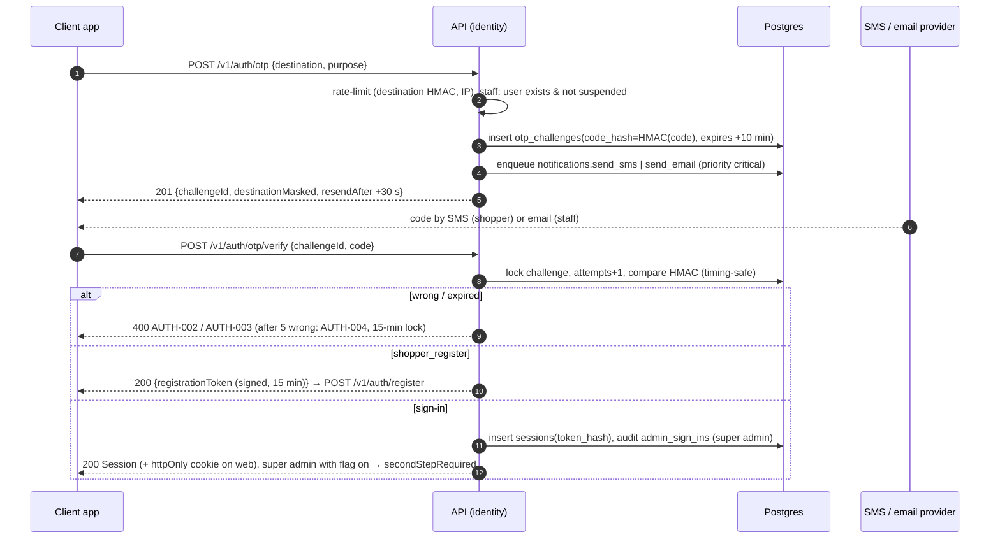

| Element | Specification |
|---|---|
| Code | 6 digits from `crypto.randomInt`; stored as HMAC-SHA256(`OTP_PEPPER`, challengeId‖code); 10-minute expiry; single use; 5 attempts per challenge |
| Shopper registration | `shopper_register` verify → signed registration token (HMAC, 15 min, bound to phone HMAC + device) → `POST /v1/auth/register` with name, optional email, privacy notice version, separate unticked marketing consent (SH-06, SH-07); consents written to `pii.consents`; guest orders on the same device within 30 days can claim stars (ST-07). If the phone already exists, the flow signs the shopper in instead (no duplicate accounts). |
| Staff invite | Admin creates `users` (pending) + `staff_invites` (token SHA-256, 7 days, single use — NF-28); email with `https://stores.skipa.ng/invite/<token>` (exit checkers: `https://exit.skipa.ng/invite/<token>`); first successful code verification with `inviteToken` activates the user and marks the invite accepted (`staff_invite_accepted`). |
| Sessions | 32 random bytes, base64url; only SHA-256 stored. Web: per-surface httpOnly cookie `__Host-skipa_<surface>` (`Secure; SameSite=Lax; Path=/`), mutating requests must carry `X-Skipa-Client` (forces CORS preflight → blocks CSRF). Native/exit devices: `Authorization: Bearer`. |
| Timeouts | Shopper: 90 days sliding. Exit: 12 h idle (design setting, RB-06), "Hand over" revokes. Store: 8 h idle (configurable). Super admin: 30 min idle, 12 h absolute (SA-01). `last_seen_at` updated at most once a minute. |
| Super admin second step | TOTP (otplib, SHA-1, 30 s, ±1 step) behind flag `superadmin_second_step`; secret encrypted with `TOTP_ENCRYPTION_KEY`; must be switched on before a second super admin is invited (enforced: inviting a second super admin fails with `AUTH-010` while the flag is off). Every sign-in recorded with IP and user agent; new device → email + Telegram notice (NF-27). |
| Device token (guests) | `POST /v1/devices` returns `deviceId` + HMAC-signed token (`DEVICE_TOKEN_SECRET`), sent as `X-Skipa-Device`; ties guest orders and receipts to the device (3, SH-21). |

**RBAC.** Permissions are strings checked by a `requirePermission()` Fastify hook; roles map to permissions in `packages/domain/rbac.ts` (single source, also used by the dashboards to hide UI):

| Permission | Exit checker | Store manager | Head office admin | Super admin | Support agent |
|---|---|---|---|---|---|
| `exit.check` | own branch | — | — | — | — |
| `live.read`, `receipts.read`, `exit_log.read` | — | assigned branches | all branches | all | read |
| `refunds.approve` (≤ threshold) / `refunds.decline` | — | ✓ | ✓ | — | — |
| `refunds.approve_head_office` (> ₦20,000) | — | — | ✓ | — | — |
| `refunds.record_payment` | — | ✓ | ✓ | — | — |
| `support.reply`, `support.escalate` | — | ✓ | ✓ | ✓ | — |
| `branch.switch` | — | own branches | all | all + platform | — |
| `staff.invite` | — | exit checkers & managers for own branches | any store role in org | Skipa team + any | — |
| `settings.flagging.update`, `settings.limits.update`, `settings.channels.update` | — | — | ✓ | ✓ | — |
| `catalogue.update`, `branding.publish`, `faqs.update` | — | branch details only | ✓ | ✓ (reset) | — |
| `recon.read`, `recon.resolve`, `payouts.read` | — | read | ✓ | ✓ | read |
| `exports.create`, `audit.read`, `data_requests.read` | — | exports (own branches) | ✓ | ✓ | — |
| `admin.*` (stores, billing, flags, config, users, view-as, platform switch) | — | — | — | ✓ | GET only, masked |

**Organisation and branch isolation (DM-04, RB-01).** Every authenticated request builds `scope = {organisationIds, branchIds, readOnly}`. Repositories require a scope argument (compile-time) and add `organisation_id`/`branch_id` predicates; the transaction runs `SET LOCAL app.org_ids = '<ids>'` so PostgreSQL RLS (`schema.sql` §16) blocks any query that forgets. Platform jobs and super admin routes use the `skipa_platform` role (BYPASSRLS). A dedicated test suite logs in as each role and asserts 403/empty results across organisations and branches (§13).

**Personal data reason gate (RB-05).** Super admin lists show masked names/phones. `POST /v1/admin/personal-data-access` with a reason (≥ 10 chars) returns a 30-minute grant token; requests carrying `X-Skipa-Access-Grant` return unmasked fields; each grant is logged in `audit.personal_data_access` and shown to that store's head office (RB-07). "View as store" (SA-03) issues a read-only token: every mutating route returns `403 AUTH-008` and the store's audit log records the view.

### 6.4 State machines

**Order** (CS-01: every transition writes `order_status_history` with actor, time, request ID)

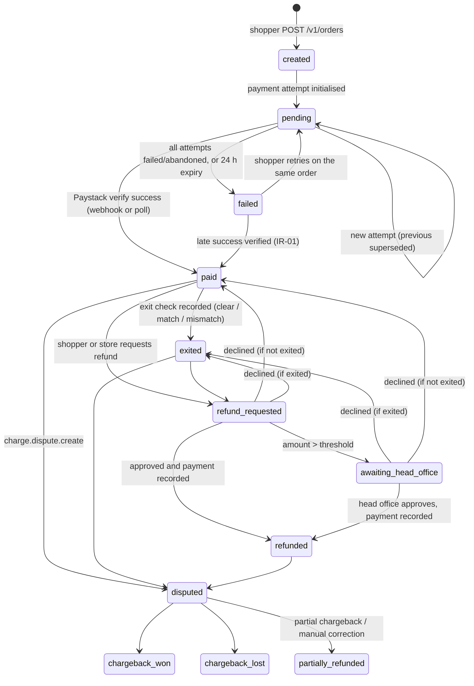

| From → To | Trigger | Who | Guard |
|---|---|---|---|
| — → created | `POST /v1/orders` | Shopper | Session active; branch on; payments available; prices equal server prices; limits; every product sellable |
| created/failed → pending | `POST …/payment-attempts` | Shopper | Order not paid; channel enabled (PY-11) |
| pending/failed → paid | `payments.process_webhook` or `payments.verify` | System (Paystack) | Verify: status `success`, amount = attempt amount, currency NGN, reference matches, subaccount = organisation's; no other successful attempt |
| pending → failed | verify returns failed/abandoned; sweep after 24 h | System | No other attempt pending |
| paid → exited | `POST /v1/exit/lookups` (clear) or `…/complete` | Exit checker | Token valid, unused, same branch, within window |
| paid/exited → refund_requested | `POST …/refund-requests` / `POST /v1/store/refunds` | Shopper / manager | No live refund; not chargeback_lost |
| refund_requested → awaiting_head_office | automatic | System | amount > `refund_head_office_threshold_kobo` |
| → refunded | `POST /v1/store/refunds/{id}/payment` | Manager / head office | Refund approved; method + date (+ reference for transfer) |
| → declined path | `POST …/decline` | Manager / head office | Reason required |
| → disputed / won / lost | Paystack dispute webhooks | System | — |
| → partially_refunded | Partial chargeback, or super admin manual correction | System / super admin | Reason; financial_adjustments row |

**Payment attempt:** `initialized → pending → success | failed | abandoned | superseded`. A superseded or failed attempt that later verifies `success` while the order is already paid creates a `stray_charges` row (`duplicate_charge`), raises alert `PAY-011` and opens a store-initiated refund with `liability = skipa` (IR-02).

**Refund (AD-07):** `requested → (awaiting_head_office) → approved → paid` or `→ declined`. `paid` means "recorded as paid by the store". On `paid`: POS refund posting (PO-04), stars reversed (ST-06), shopper notified (in app + email if known), `refund_resolved`. **No Paystack refund call exists in the codebase**; a lint rule forbids importing the Paystack refund endpoint.

**Exit check:** `open (flagged) → completed(match|mismatch)`; `open → abandoned` after 30 min by job; clear checks are created already completed.

**Dispute:** `open → evidence_submitted → awaiting_bank → won | lost`; `open → accepted` (auto-accepted if the 16-hour deadline passes).

**Support ticket:** `new → in_progress ↔ waiting_for_shopper → resolved` (HP-11); a shopper message on a resolved ticket reopens it to `in_progress`.

**Staff invite / user:** `pending → active → suspended ↔ active → removed`; `pending → cancelled | expired`.

### 6.5 Exit check design

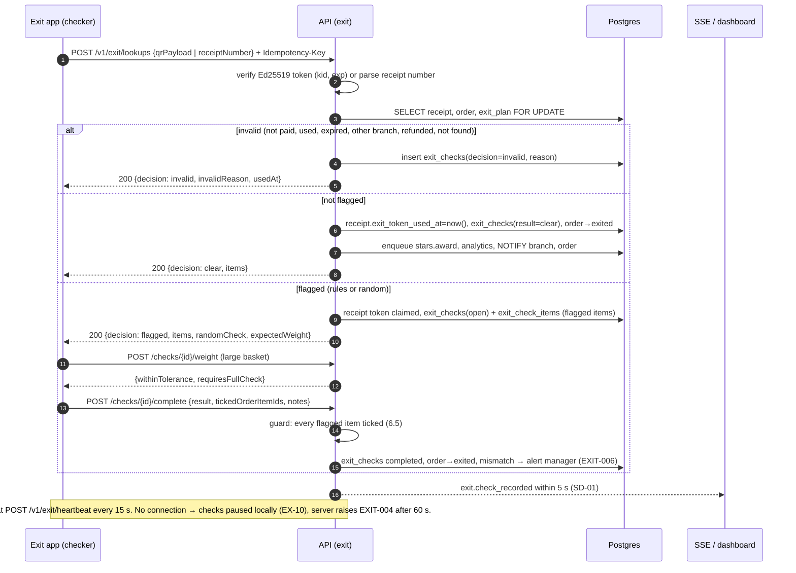

- **Exit token (NF-10):** compact `v1.<kid>.<base64url(payload)>.<base64url(Ed25519 sig)>`, payload `{"j":"<exit_token_id>","b":"<branchId short>","e":<exp unix>}` (~120 chars, fits QR version 6). It carries no receipt data (D-16). Keys `EXIT_TOKEN_SIGNING_KEYS` (JSON array of `{kid, privateKeyPem}`), rotated yearly with overlap.
- **Flagging plan decided at Paid** (`exit_plans`, append-only) from the branch settings in force at that moment: extra-checks category or product (CT-04), item ≥ price threshold, item count > N (weigh), basket value > amount (weigh), previous mismatch within 90 days for the same shopper or device (design rule), random selection. **Random selection** uses `random_check_blocks`: per branch, a block of `200/rate` receipts (15% → 40) with exactly k selected positions chosen by CSPRNG; this keeps any 1,000-receipt window within 0.5 pp of the rate (simulated) and meets the 6.6 acceptance test, while positions stay unpredictable. Changing the rate starts a new block (EX-11, logged).
- **Weight (EX-04):** expected = Σ(item weight × qty); within ±`weight_tolerance_bps` → match path; outside → every item becomes flagged (full check).
- **Rules (6.5):** `complete` rejects with `EXIT-007` unless all flagged items are ticked; mismatch requires at least one reason; a re-scan of a receipt with an open check by the same branch resumes that check (not "already used").
- **Online only (D-16, EX-10):** the exit app checks `navigator.onLine`, heartbeat responses and request failures; after 2 failed requests or 20 s without a heartbeat ack it shows the "No connection · checks paused" screen. The server's `exit.heartbeat_monitor` (15-second in-process tick with a Postgres advisory lock) marks devices offline after 45 s and alerts the store manager at 60 s (dashboard + email, `EXIT-004`, `exit_device_offline`); `exit_device_online` on recovery.
- **Unusual checker patterns (EX-08, Q22):** nightly job computes per checker over trailing flagged checks: mismatch rate < ⅓ of branch rate over ≥ 100 flagged checks; median flagged-check duration < 6 s; large baskets completed without a weight. Shown as signals only.

### 6.6 Paystack integration

**Model (AD-06):** Skipa's Paystack business is the main integration; each store organisation has a **subaccount** created at onboarding (`POST /subaccount` with business name, bank code, account number, `percentage_charge` = platform fee %, 0 for pilot stores). Every transaction is initialised with that subaccount, `transaction_charge` = the Skipa fee in kobo for this order, and `bearer: "subaccount"` so **the store pays Paystack's fee**. Paystack settles the store share to the store's bank and Skipa's fee to Skipa's account; Skipa never holds the sale amount. Refunds are not processed through Paystack (AD-07).

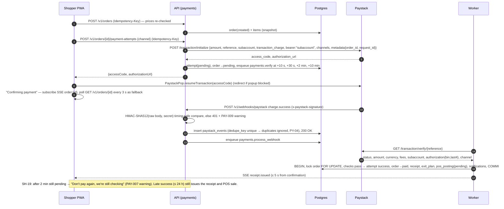

| Topic | Specification |
|---|---|
| Keys | `PAYSTACK_SECRET_KEY`, `PAYSTACK_PUBLIC_KEY`; `sk_test_`/`pk_test_` in local and staging, `sk_live_` only in production (startup check refuses a live key outside `NODE_ENV=production` and a test key inside it) |
| Customer email | Paystack requires an email at initialise; Skipa sends a pseudonymous per-order address `o-<orderId>@pay.skipa.ng` (no personal data; MX accepts and discards). Paystack customer receipt emails are turned off in the dashboard. |
| Channels | `channels` limited to the requested channel among `card`, `bank_transfer`, `ussd` enabled for the branch (PY-11). International cards are disabled on the integration during the pilot. |
| Fee | `transaction_charge = round_half_up(total_kobo × platform_fee_bps / 10,000)`; pilot = 0 (and subaccount `percentage_charge` 0). Stored on the order and attempt; the expected Paystack fee is computed only for reconciliation (1.5% + ₦100, ₦100 waived under ₦2,500, cap ₦2,000). **Sandbox test required:** behaviour of `transaction_charge: 0` and of `bearer: "subaccount"` with a 0% subaccount. |
| Re-use of an attempt | If a pending attempt for the same channel is < 30 min old, the same `accessCode` is returned (prevents two live charges). Otherwise the old attempt is marked `superseded`. |
| Verification rules (PY-02) | Receipt only when verify returns `status = success` **and** `amount` = attempt amount **and** `currency = NGN` **and** reference matches **and** subaccount matches. Mismatch → no receipt, `PAY-010` critical alert, `stray_charges` row. |
| Polling (PY-03) | Jobs at +10 s, +30 s, +2 min, +10 min after initialise, then `payments.sweep_pending` every 5 min for attempts 10 min–24 h old; `POST /v1/orders/{id}/verify` lets the client ask for an immediate check (rate-limited, never trusted as success). |
| Duplicate webhooks (PY-04) | `dedupe_key = sha256(event ‖ data.id ‖ data.status ‖ data.reference)` unique; processing is itself idempotent (state checks inside the transaction). AC 8.5: replaying the same webhook 10 times → one Paid order. |
| Dispute evidence (PY-06, PY-09) | Receipt stores `dispute_evidence` (amount, date, items, channel, card BIN + last 4). On `charge.dispute.create` the worker builds a PDF (pdfkit 0.21.0): receipt, item list with prices "as charged", payment details, exit check log with checker and time, refund record if any; then `GET /dispute/:id/upload_url` → PUT file → `POST /dispute/:id/evidence` → `PUT /dispute/:id/resolve` (`resolution: declined`). Deadline is **16 hours** for Nigerian merchants (Paystack support, checked 24 Nov 2026): Telegram alert to the super admin at 2 h if not submitted, critical at 8 h (PY-09). Endpoint field names to be confirmed in the sandbox. |
| Lost chargeback (AD-09) | Order → `chargeback_lost`; `financial_adjustments(kind=chargeback_receivable, +amount)` (store owes Skipa); `chargeback_reserve_ledger(chargeback_debit, −amount)`; POS chargeback posting (PO-04, PY-10); stars reversed (ST-06); shown on the payout report. Reserve below `chargeback_reserve_low_water_kobo` (₦100,000) → Telegram alert. |
| Settlements | `recon.fetch_settlements` calls `GET /settlement?subaccount=<code>&from&to` and `GET /settlement/:id/transactions` hourly 07:00–21:00 WAT; stores lines in `settlement_lines`; triggers `recon.daily` for that business date. |
| Availability (NF-05) | Circuit breaker around Paystack calls: if > 50% of initialise/verify calls fail over 2 minutes (or 5 consecutive timeouts), platform flag `payments_available=false` → check-in and cart show "Pay at the till" (01.3, 04.6); half-open retry every 60 s; critical alert. Super admin can force either state. Timeouts: initialise 8 s, verify 5 s; retries with jitter (NF-03). |
| Logging (ER-05) | Every Paystack call logged with method, path, status, duration, reference, request ID; bodies scrubbed of email, authorization codes and account numbers. |
| Webhook IPs | Paystack publishes source IPs; add them as a Cloudflare WAF allow rule for `/v1/webhooks/paystack` once confirmed from Paystack's docs (signature check remains mandatory). |

### 6.7 POS connector framework

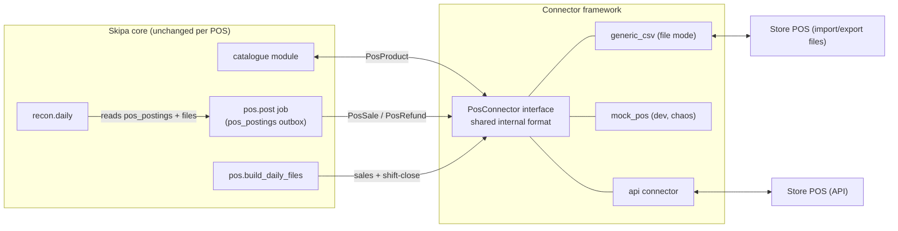

```ts
// packages/domain/pos.ts — the shared internal format
export type PosProduct = { posProductId: string; barcode: string | null; name: string; department: string | null;
  branchCode: string; priceKobo: number; stockQty: number | null; active: boolean; variablePrice: boolean; soldByWeight: boolean };
export type PosSale = { idempotencyKey: string; receiptNumber: string; branchCode: string; tillId: string; paidAt: string;
  lines: { posProductId: string; barcode: string | null; quantity: number; unitPriceKobo: number; lineTotalKobo: number }[];
  totalKobo: number; tenders: { channel: 'card' | 'bank_transfer' | 'ussd'; amountKobo: number; reference: string }[] };
export type PosRefund = { idempotencyKey: string; originalReceiptNumber: string; branchCode: string; tillId: string;
  refundedAt: string; reason: 'refund' | 'chargeback'; lines: PosSale['lines']; totalKobo: number; method: string };
export type PosPostResult = { ok: true; posReference: string } | { ok: false; retryable: boolean; code: string; detail: string };

// apps/api/src/integrations/pos/connector.ts
export interface PosConnector {
  key: string;                                    // 'generic_csv', 'mock_pos', '<vendor>_api'
  mode: 'api' | 'file';
  capabilities: { pullCatalogue: boolean; pushWebhook: boolean; postSale: boolean; postRefund: boolean; shiftClose: 'api' | 'file' | 'none' };
  testConnection(ctx: ConnectorCtx): Promise<{ ok: boolean; detail: string }>;
  pullCatalogue?(ctx: ConnectorCtx, since: Date | null): AsyncIterable<PosProduct>;
  verifyPush?(ctx: ConnectorCtx, headers: Record<string, string>, rawBody: Buffer): PosProduct[];   // throws on bad signature
  parseProductFile?(ctx: ConnectorCtx, file: NodeJS.ReadableStream): AsyncIterable<PosProduct | { row: number; error: string }>;
  postSale?(ctx: ConnectorCtx, sale: PosSale): Promise<PosPostResult>;        // MUST be idempotent on idempotencyKey/receiptNumber
  postRefund?(ctx: ConnectorCtx, refund: PosRefund): Promise<PosPostResult>;
  buildSalesFile?(ctx: ConnectorCtx, date: string, items: (PosSale | PosRefund)[]): Promise<{ filename: string; contentType: string; body: Buffer }>;
  buildShiftClose?(ctx: ConnectorCtx, date: string, report: ShiftCloseReport): Promise<{ filename: string; contentType: string; body: Buffer }>;
}
```

| Concern | Rule |
|---|---|
| Modes | **API:** prices/stock pulled every 5 min (`pos.pull_catalogue`) or pushed (`POST /v1/webhooks/pos/{connectorKey}/{organisationId}`); each sale/refund posted as it happens to the "Skipa" till (`pos_connections.skipa_till_id`). **File:** product file uploaded daily or on price change; sales/refunds file and shift-close generated at 23:30 WAT for upload by 09:00 (design SD-Recon). |
| Outbox | `pos_postings` row created in the same transaction as Paid / refund recorded / chargeback lost; `idempotency_key = sale:<orderId>` etc. |
| Idempotency at the POS | Connector sends the receipt number as the POS reference; if the POS cannot enforce uniqueness, the connector must look the reference up before posting (required test: 2-hour outage → all sales post once, no duplicates, 12.5). |
| Retries (PO-05) | Backoff 1, 2, 5, 10 min, then every 10 min for 24 h; permanent errors (validation) stop immediately as `POS-010`. After 5 failures: alert head office (dashboard + email) and super admin (Telegram). After 24 h: `dead` → reconciliation item `pos_missing`. Per-organisation circuit breaker pauses posting 10 min after 5 consecutive failures. |
| Catalogue sync | Upsert `products` (by `pos_product_id`) and `branch_products`; append `product_price_history`; products with "Sold through Skipa: off" still sync (PO-10); missing barcode/weight, variable price or sold-by-weight → not sellable (CT-05). Any change debounces `catalogue.rebuild_snapshot` (≤ 30 s) and pushes `catalogue.updated` to active sessions; price change visible ≤ 5 min (PO-02). |
| Stale prices (12.4) | `price_synced_at` older than `stale_price_hours` (24 h) → product shown as "Price being updated — pay at the till" (design 03.4). |
| Health (PO-09) | `pos_sync_runs` + postings → last sync, failures in 24 h on both dashboards. |
| Adding a connector | 1) Create `integrations/pos/<vendor>/` implementing `PosConnector`; 2) map vendor fields to the shared types; 3) write contract tests against recorded fixtures (`__fixtures__/<vendor>/*.json`) and the store's test environment; 4) run the shared conformance suite `pnpm test:pos-conformance <key>` (idempotency, outage recovery, price change, refund, malformed data); 5) register in `integrations/pos/registry.ts`; 6) document credentials in `infra/secrets` and the onboarding runbook. No core change allowed. |
| Pilot (12.6, POS unknown) | Build `generic_csv` (file mode, column spec in `docs/pos/generic_csv.md`) and `mock_pos` first; build the API connector when the first pilot store's POS is known. |

**Generic CSV file spec (v1).** Product file: `pos_product_id,barcode,name,department,branch_code,price_naira,stock_qty,active` (UTF-8, comma, header row, prices in naira with 2 decimals converted to kobo). Sales file: one row per line `receipt_number,branch_code,till_id,paid_at_wat,pos_product_id,barcode,quantity,unit_price_naira,line_total_naira,tender_channel,tender_reference,type(sale|refund|chargeback)`. Final layouts are adjusted per POS import format at onboarding.

### 6.8 Reconciliation

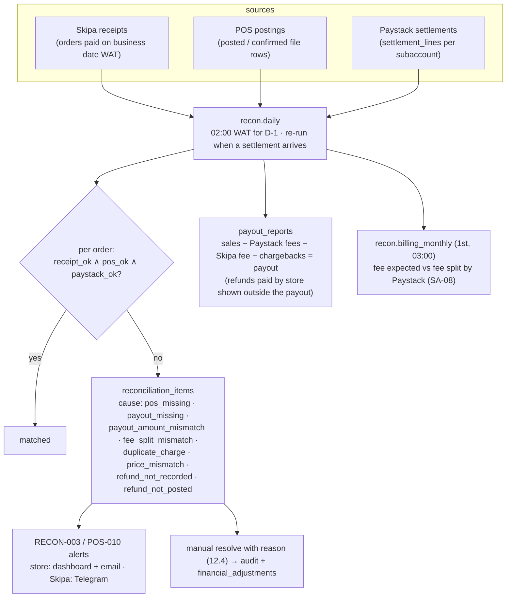

Matching keys: receipt ↔ POS by receipt number and total; receipt ↔ Paystack by reference and amount; Paystack line must show `skipa_share = platform_fee_kobo` (± ₦1 rounding) and the fee borne by the subaccount. Orders not yet settled stay `awaiting_payout` until settlement date + 2 business days, then become `payout_missing`. Off-platform refunds (AD-07) are matched receipt ↔ refund record ↔ POS refund posting; an approved refund not recorded after 24 h becomes `refund_not_recorded`. Acceptance (12.5): a 500-order test day matches every order or lists it with a cause.

### 6.9 Notifications and alerts

| Event | Recipient | Channel (AD-02, AD-03, AD-05) | Template key |
|---|---|---|---|
| Shopper sign-in / registration code | Shopper | **SMS** (only SMS use) | `shopper_code` |
| Staff / exit checker / super admin sign-in code | Staff | Email | `staff_code`, `admin_code` |
| Staff invite | New staff | Email | `staff_invite` |
| Receipt issued | Shopper | In app; email if "Email my receipts" or on tap | `receipt` |
| Refund approved / declined / paid (recorded) | Shopper | In app (+ email if known) | `refund_update` |
| Store reply to support | Shopper | In app Support tab (+ email if known) | `support_reply` |
| Refund requested; refund needs head office | Manager; head office | Dashboard + email | `refund_requested`, `refund_head_office` |
| Approved refund not recorded (24 h / 48 h) | Manager / head office | Dashboard + email | `refund_record_reminder` |
| Exit mismatch | Manager | Dashboard + email | `exit_mismatch` |
| Exit device offline > 60 s | Manager | Dashboard + email | `exit_offline` |
| Unusual checker pattern | Manager, head office | Dashboard + daily email | `checker_signal` |
| POS sync failure (5 postings) | Head office | Dashboard + email | `pos_failing` |
| Payout mismatch | Head office | Dashboard + email | `payout_mismatch` |
| Chargeback raised | Head office | Dashboard + email | `chargeback_raised` |
| Ticket past first-reply target | Head office | Dashboard + email | `ticket_late` |
| Daily summary (21:30 WAT) | Managers, head office | Email | `daily_summary` |
| Weekly loss report (Mon 08:00, pilot only) | Head office | Email | `weekly_loss` |
| Any platform alert (critical, high; medium as daily digest) | Skipa team | **Super admin alert centre + Telegram**; email only if Telegram fails after retries **and** the watchdog/API can still send | `platform_alert` |

**Email budget guard (Resend Free: 100/day, 3,000/month — AD-14).** `notifications.send_email` counts today's sends (WAT) and this month's. Reserved budget: 40/day for `critical` priority (codes, invites, store critical alerts). Receipts and summaries are `bulk`: when the remaining daily budget would fall below the reserve they are set to `held_quota` and released at 06:00 WAT by `notifications.email_budget_release`. When held receipts occur on 3 days in a week, a Telegram alert recommends upgrading to Resend Pro (switch trigger). Bounces/complaints from the Resend webhook mark addresses as undeliverable (`NOTIF-005`).

**SMS (NT-05).** `SmsProvider` interface with `africastalking` (primary) and `termii` (failover after a send error or no delivery report within 60 s for a code); delivery reports via webhooks update `notifications`; failures log `NOTIF-002`.

**Telegram (AD-05).** Bot token `TELEGRAM_BOT_TOKEN`, group `TELEGRAM_ALERT_CHAT_ID`. Messages: `🔴 CRITICAL PAY-007 · Payment verification timed out · Harbour Grocers · 212 events · https://admin.skipa.ng/errors/PAY-007` (emoji only as severity marker). Dedupe by `alerts.dedupe_key`; re-notify every 30 min while open for critical. If the Bot API returns an error after 3 retries, the alert is emailed to `PLATFORM_ALERT_EMAIL`. When the whole platform is down, Uptime Kuma (Lagos) sends Telegram, with SMTP (Resend) as its fallback notification.

### 6.10 Background jobs

pg-boss 12 queues; cron times in WAT (`tz: 'Africa/Lagos'`). Every job: `retryLimit`, `retryBackoff: true`, `expireInSeconds` as listed, `singletonKey` where noted, request ID propagated, failures logged with code and alerting per §10.5. Sub-minute work uses in-process ticks guarded by a Postgres advisory lock (pg-boss cron is minute-granular).

| Job | Trigger / schedule | Retries · timeout | Alerts on failure | PRD |
|---|---|---|---|---|
| `payments.verify` | Delayed +10 s, +30 s, +2 min, +10 min per attempt | 3 · 15 s | PAY-007 warning at 2 min pending; critical if Paystack unreachable 2 min | PY-03 |
| `payments.process_webhook` | Each webhook | 5 · 30 s | PAY-008 high | PY-02, PY-04 |
| `payments.sweep_pending` | `*/5 * * * *` | 3 · 120 s | high if backlog > 50 | PY-03, 8.5 |
| `payments.availability` | In-process every 30 s | — | critical when breaker opens | NF-05 |
| `receipts.email` | On paid (opt-in) / on request | 5 · 30 s | NOTIF-005 medium | SH-21 |
| `exit.heartbeat_monitor` | In-process every 15 s | — | EXIT-004 store alert at 60 s | EX-10, NF-26 |
| `exit.abandon_open_checks` | `*/5 * * * *` | 3 · 60 s | low | 6.5 |
| `exit.checker_signals` | `0 6 * * *` | 3 · 10 min | — | EX-08 |
| `sessions.timeout` | `* * * * *` | 3 · 60 s | — | SH-03 |
| `catalogue.rebuild_snapshot` | On catalogue change (singleton per branch, debounce 30 s) | 5 · 60 s | high after 3 failures | SH-11, PO-02 |
| `catalogue.stale_price_check` | `*/15 * * * *` | 3 · 60 s | medium | 12.4 |
| `pos.pull_catalogue` | `*/5 * * * *` per API-mode org (singleton) | 3 · 4 min | POS-002 high after 3 runs | PO-02 |
| `pos.import_file` | On upload | 3 · 10 min | POS-004 to uploader | 12.1 |
| `pos.post` | Outbox, backoff schedule §6.7 | per schedule · 30 s | POS-010 after 5 failures | PO-03–05 |
| `pos.build_daily_files` | `30 23 * * *` | 5 · 10 min | high | PO-06, 12.1 |
| `recon.fetch_settlements` | `0 7-21 * * *` | 5 · 5 min | RECON-001 high | PO-07 |
| `recon.daily` | `0 2 * * *` + on settlement arrival | 3 · 30 min | RECON-003 high on mismatch | PO-07, PO-08 |
| `recon.billing_monthly` | `0 3 1 * *` | 3 · 30 min | RECON-005 high on fee mismatch | SA-08 |
| `disputes.respond` | On dispute webhook | 5 · 2 min | PAY-012 critical if not submitted in 2 h | PY-09 |
| `disputes.deadline_watch` | `*/15 * * * *` | 3 · 60 s | critical at 8 h before deadline | PY-09 |
| `refunds.record_reminder` | `0 * * * *` | 3 · 60 s | store email at 24 h, head office at 48 h | PY-07 |
| `support.sla_watch` | `*/5 * * * *` (opening hours) | 3 · 60 s | store email; escalate to head office | HP-12 |
| `notifications.send_email` / `send_sms` / `send_telegram` | Queue | 5 / 3 / 3 · 20 s | NOTIF-002 / NOTIF-005 / email fallback | NT-05, NT-06 |
| `notifications.email_budget_release` | `0 6 * * *` | 3 · 120 s | — | AD-14 |
| `reports.daily_summary` | `30 21 * * *` | 3 · 10 min | medium | SD-06 |
| `reports.weekly_loss` | `0 8 * * 1` (pilot orgs only) | 3 · 10 min | medium | SD-07 |
| `stars.award` / `stars.reverse` | On exited / refund paid / chargeback lost | 5 · 30 s | medium | ST-01, ST-06 |
| `analytics.forward_posthog` | `*/5 * * * *` (≤ 900k events/month cap) | 3 · 2 min | low | AN-05 |
| `analytics.partitions_maintain` | `0 1 * * *` | 3 · 60 s | high (would break ingest) | AN-11 |
| `privacy.process_requests` | `0 * * * *` | 3 · 30 min | high if due < 5 days | NF-16 |
| `privacy.retention_purge` | `30 3 * * *` | 3 · 60 min | medium | §7.6 |
| `privacy.store_offboarding` | On organisation ended; daily check | 3 · 60 min | high | NF-17 |
| `exports.build` | On request | 2 · 15 min | to requester | SD-05 |
| `invites.expire` | `0 * * * *` | 3 · 60 s | — | NF-28 |
| `alerts.digest` | `0 8 * * *` | 3 · 60 s | — | 14.4 medium |
| `branding.process_asset` | On upload | 3 · 60 s | to uploader | BR-05 |

### 6.11 Real-time

| Channel | Subscribers (checked at connect) | Events |
|---|---|---|
| `order:<id>` | Device or shopper that owns the order | `order.updated`, `receipt.issued`, `refund.updated` |
| `device:<id>` / `shopper:<id>` | That device / shopper | `ticket.message`, `ticket.updated`, `refund.updated` |
| `session:<id>` | That shopping session | `branch.status` (switch-off ≤ 10 s, 10.4 AC), `catalogue.updated` |
| `branch:<id>` | Staff with the branch in scope | `live.counters`, `receipt.issued`, `exit.check_recorded`, `exit.device_status`, `refund.updated`, `ticket.updated`, `alert.raised`, `branch.status` |
| `org:<id>` | Head office | Same as branch, all branches |
| `platform` | Super admin | `alert.raised`, `live.counters` |

Mechanics: services call `realtime.publish(channel, type, data)` inside the transaction → `pg_notify('skipa_events', json)` (delivered at commit; payload ≤ 8 KB, ids + small data). Each API process LISTENs once and fans out to its SSE connections (`GET /v1/stream?channels=…`). Keep-alive comment every 25 s (Cloudflare idle limit 100 s); each process keeps a 5-minute ring buffer for `Last-Event-ID` resume; older gaps → client refetches. **Fallback:** if the stream is down > 10 s, clients poll the relevant REST endpoints every 5 s (pending payment every 3 s), which still meets SD-01 and EX-10.

### 6.12 Help chatbot and support

`POST /v1/help/match` normalises the question (lower-case, synonyms from `faq_synonyms`, e.g. "debited" → charged), runs `websearch_to_tsquery` against `faqs.search_vector` filtered by scope (Skipa FAQs on Skipa home/Support tab, store FAQs inside a store — HP-15), and combines `ts_rank` with a `pg_trgm` similarity score. Confidence ≥ 0.35 → answer; otherwise `offerSupport: true` (HP-05). For payment questions with an `orderId`, the answer is generated from the **real order state** (HP-04) and never claims success before Paid. Payment, refund and exit topics always offer "Message store support" first (HP-07). Tickets snapshot order/payment state, Paystack reference, amount, device, chat and recent request IDs (HP-08); guests may add an optional email (AD-10).

### 6.13 Stars, branding, analytics modules (specifics)

- **Stars:** awarded on Exited with result clear or match (none on mismatch), 1 per visit, capped per store per WAT day (ST-03) using `award_date_wat`; balance = `SUM(delta)` (ST-05); reversal rows on refund paid or chargeback lost (ST-06); guest claim within 30 days on the same device (ST-07); suspended accounts earn nothing; tiers stored but off (ST-10).
- **Branding:** draft → server computes brand slots (hover/pressed = primary darkened 8%/16% in OKLCH; `on-primary` = white or ink, whichever reaches 4.5:1; `primary-text` darkened until 4.5:1 on white; subtle tints) and a contrast report; publish blocked unless all pairs pass (BR-04) with a suggested shade; images re-encoded to WebP with `sharp` (logo ≤ 50 KB, cover ≤ 150 KB, BR-05); one published version, history kept, restore = new draft from an old version (BR-03); every change audited (BR-09). Exit mode, Pay body, status colours and exit QR never use brand slots (BR-06).
- **Analytics ingest:** `POST /v1/events` validates names against the tracking plan, adds standard properties server-side (request ID, app version from `X-Skipa-Client`, store/branch from the session, network type from the client), drops unknown events (logged), and inserts into `analytics.events`.

---

## 7. Data design

The complete DDL is `db/schema.sql` (validated by loading it into PostgreSQL; constraint, append-only and RLS behaviour smoke-tested). It becomes Drizzle migration `0000_init`; `apps/api/src/db/schema.ts` mirrors it table for table.

### 7.1 Principles

| Rule | Implementation | PRD |
|---|---|---|
| Money in kobo | `bigint` columns ending `_kobo`, `CHECK (> 0 / ≥ 0)`; `packages/domain/money.ts` is the only arithmetic; rounding half-up to the kobo for fees | PY-05, DM-01 |
| Sale-time snapshot | `order_items` stores name, category, check level, unit price, weight at sale; `CHECK (line_total = unit × qty)` | DM-02 |
| Never overwrite financial history | Append-only trigger on `order_items`, `order_status_history`, `refund_status_history`, `exit_plans`, `financial_adjustments`, `chargeback_reserve_ledger`, `star_ledger`, `product_price_history`, `pii.consents`, all `audit.*` | CS-04, DM-03, ST-05 |
| Tenant isolation | `organisation_id` on every tenant row + RLS policy `tenant_isolation` + scope-checked repositories | DM-04 |
| Personal data apart | `pii` schema: shoppers (phone/email encrypted with AES-256-GCM, HMAC lookup keys), consents, visited stores, data requests, guest contact details. Orders reference `shopper_id` logically, so deleting a shopper never breaks financial records | DM-05, DM-06 |
| One success per order | Partial unique index `one_successful_attempt_per_order`; `UNIQUE (device_id, idempotency_key)` on orders | PY-01 |
| Exit once | `receipts.exit_token_used_at` set under row lock; `one_open_check_per_order` partial unique index | SH-23, 6.6 |
| One live refund per order, whole order only | `one_live_refund_per_order`; amount = order total (service check) | Q04 |

### 7.2 Entity overview

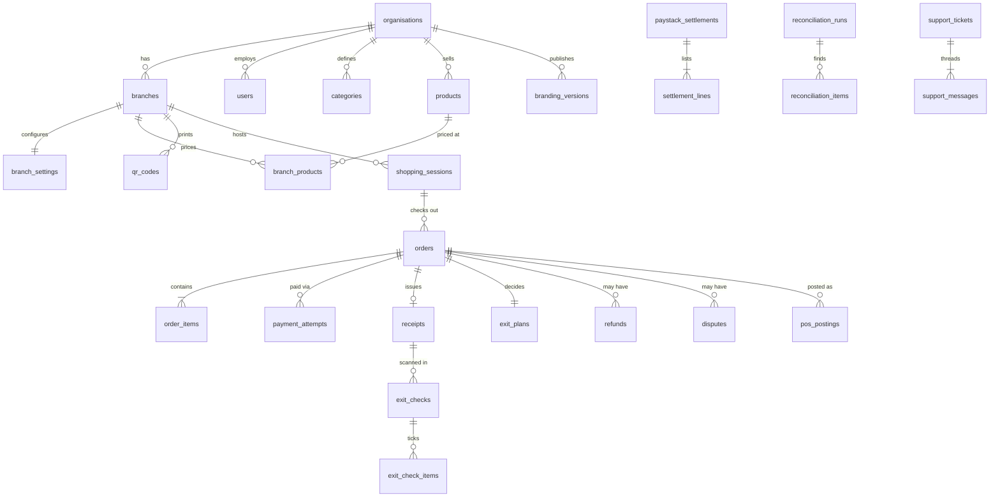

### 7.3 Table groups (columns, keys and indexes in `db/schema.sql`)

| Group | Tables |
|---|---|
| Platform config | `platform_settings`, `feature_flags`, `standard_categories`, `notification_templates`, `star_rules` |
| Tenancy | `organisations` (plan, pilot end, fee bps, Paystack subaccount, POS mode), `branches` (code, location, hours, switch-off, random rate), `branch_settings` (all thresholds — CS-06), `qr_codes` |
| Identity | `users`, `user_branches`, `staff_invites`, `devices`, `otp_challenges`, `sessions`, `known_admin_devices`; `pii.shoppers`, `pii.shopper_devices`, `pii.consents`, `pii.visited_stores`, `pii.data_requests`, `pii.contact_details` |
| Catalogue | `categories`, `branch_categories`, `pos_department_mappings`, `products`, `branch_products`, `product_price_history`, `catalogue_snapshots`, `loss_baselines`, `loss_counts` |
| Shopping & payments | `branch_counters`, `shopping_sessions`, `unknown_barcodes`, `orders`, `order_items`, `order_status_history`, `payment_attempts`, `paystack_events`, `stray_charges`, `receipts`, `receipt_deliveries` |
| Exit | `exit_plans`, `random_check_blocks`, `exit_devices`, `exit_checks`, `exit_check_items`, `checker_signals` |
| Refunds & disputes | `refunds`, `refund_status_history`, `disputes`, `financial_adjustments`, `chargeback_reserve_ledger` |
| Stars | `star_ledger` |
| POS & reconciliation | `pos_connections`, `pos_sync_runs`, `pos_files`, `pos_postings`, `paystack_settlements`, `settlement_lines`, `reconciliation_runs`, `reconciliation_items`, `payout_reports`, `billing_statements` |
| Support & notifications | `support_tickets`, `support_messages`, `faqs`, `faq_synonyms`, `notifications`, `notification_preferences`, `alerts` |
| Branding, tours, ops | `branding_versions`, `tour_progress`, `exports`, `idempotency_keys`, `error_events` |
| Audit | `audit.audit_log`, `audit.personal_data_access`, `audit.admin_sign_ins` |
| Analytics | `analytics.events` (partitioned by month) |

**Numbering.** `branch_counters` gives gap-free per-branch sequences (`UPDATE … SET next_value = next_value + 1 RETURNING`, in the order transaction): order `SKP-LK-04815`, receipt `LK-04822`, ticket `T-LK-00231`, Paystack reference `SKP-LK-04815-A1` (attempt suffix).

### 7.4 Migrations

- Drizzle Kit generates SQL into `db/migrations/NNNN_name.sql`; engineers review and may hand-edit (e.g. partial indexes, triggers, RLS); migrations are committed and run by `pnpm db:migrate` as a release step **before** the new API version starts (§12.4).
- Expand → migrate → contract: additive changes first (nullable column, new table), backfill in a job, switch code, drop old structures in a later release. No destructive change in the same release as the code that stops using it.
- Every migration has a tested down path or an explicit "forward-only" note with a restore plan; CI applies all migrations to an empty PostgreSQL 18 and to a copy of the previous release's schema.
- Long operations use `CREATE INDEX CONCURRENTLY` (separate migration, no transaction).

### 7.5 Seed data (`db/seed/`)

`pnpm db:seed` (local and staging only; refuses to run when `NODE_ENV=production`) creates:

| Seed | Content |
|---|---|
| Platform | 10 standard categories (7.2) with default check levels; default `platform_settings`; flags (`superadmin_second_step` off, `skipa_home` on, `first_time_tours` on, `connected_exit_scale` off, `referrals` off); star rules v1 (1 per visit, cap 1/store/day); all notification templates v1; 30 platform FAQs; synonyms |
| Organisations | **Adunni Mart** (pilot, ends 2027-01-15, 0%, branches LK *Lekki Phase 1* and IK *Ikeja GRA*, API mode via `mock_pos`), **Harbour Grocers** (paid, 2%, branch VI, file mode via `generic_csv`) — matching the design canvas brand modes |
| Staff | One user per role per org (`manager.lk@adunni.test`, `ho@adunni.test`, `checker.lk@adunni.test`, …), super admin `tolu@skipa.test`; in local mode the code is always `000000` (`OTP_DEV_FIXED_CODE`, rejected outside local) |
| Catalogue | ~1,300 products per branch from a generated Nigerian grocery list (realistic names, EAN-13 barcodes with valid check digits, weights, prices ₦200–₦60,000), including till-only, missing weight, variable price, extra-checks and stale-price cases |
| Activity | 30 days of orders (≈ 200/day/branch) with exits, flags, random checks, mismatches, 2 refunds in each state, 1 dispute in each state, support tickets, unknown barcodes, a POS outage window, settlements with one fee mismatch — so every dashboard screen has data |
| Shoppers | 50 registered shoppers with consents and stars; avatars across all five |

### 7.6 Retention and deletion

| Data | Retention | Mechanism |
|---|---|---|
| Orders, items, payments, receipts, refunds, disputes, adjustments, settlements | 7 years (financial records; to confirm with counsel) | Never deleted; shopper link pseudonymised on deletion |
| Shopper personal data (`pii.*`) | Until account deletion request (completed ≤ 30 days, NF-16, Q23) or store offboarding (30 days, NF-17) | `privacy.process_requests`: delete or irreversibly anonymise `pii.shoppers` (keep a tombstone id); unlink devices; remove guest contact details |
| Guest contact emails | 90 days after ticket resolution / receipt | `privacy.retention_purge` |
| Sessions, OTP challenges | 30 days after expiry | purge job |
| Idempotency keys | 24 h | purge job |
| Analytics events | 24 months (AN-11), then dropped by partition | `analytics.partitions_maintain`; aggregates kept indefinitely |
| Application logs (Loki) | 90 days (ER-04) | Loki `retention_period: 2160h` |
| Error records (GlitchTip, `error_events`), audit logs | 24 months (ER-04) | GlitchTip retention setting; audit kept 24 months then archived encrypted to R2 |
| Backups | 30 days of PITR + 12 monthly fulls | pgBackRest retention |
| Exports | Download links valid 24 h; files deleted after 7 days | `exports.build` sets `expires_at`; purge job |
| Location (Near me) | Never stored or sent | Computed on the phone (NF-29) |

---

## 8. Frontend design

### 8.1 Apps, routes and screens

Design links point to the canvas `https://claude.ai/artifact/YQNrXAXnjqDJ521Ji6zHJH#artboard-<file>`.

**Shopper PWA — `apps/shopper` (shop.skipa.ng)**

| Route | Screen (design) | Artboard | PRD |
|---|---|---|---|
| `/` | Skipa home — Home tab, last store, continue cart, recent receipts | SH-F10 (10.1) | SH-25, D-10 |
| `/scan-store` | Scan store QR | SH-F10 (10.2) | SH-01 |
| `/stores`, `/stores/:branchId` | Find a store (name/area/Near me), store page (store brand) | SH-F10 (10.3–10.4) | SH-26, D-11 |
| `/support`, `/support/:ticketId` | Support tab, ticket thread, rate support | SH-F10 (10.5), SH-F08 (08.6–08.8) | SH-27, HP-11, HP-14 |
| `/profile`, `/profile/receipts`, `/profile/stars`, `/profile/privacy`, `/profile/avatar`, `/profile/help` | Profile (Skipa brand), receipts, stars, privacy and data, avatar picker, help and app tour | SH-F06, SH-F10 (10.6–10.8) | SH-21, SH-28–31, ST-08, NF-16 |
| `/q/:qrCode` | Check-in loading, switched off, payments unavailable, first-visit intro, returning welcome | SH-F01 (01.1–01.5) | SH-01–04, NF-05 |
| `/s/:sessionId/welcome` → `/register`, `/sign-in` | Guest or register, details, code, consent, registered, "I've used Skipa before" | SH-F02 (02.1–02.6) | SH-05–08 |
| `/s/:sessionId/scan` | Scanner (ready, reading, added, offline, torch), not included, not found, price updating | SH-F03 (03.1–03.4) | SH-09–13 |
| `/s/:sessionId/cart` | Cart, empty, limit reached, price changed, switched off mid-session | SH-F03 (03.6–03.10) | SH-14–16, 5.8 |
| `/s/:sessionId/pay` → `/orders/:orderId/confirming` → `/orders/:orderId/failed` | Choose how to pay, opening Paystack, confirming, confirmed, failed, pay at till | SH-F04 (04.1–04.6) | SH-17–19, PY-01–03 |
| `/receipts/:receiptId` | Receipt with exit QR, send by email, not valid for exit, stars earned, rate visit | SH-F05 (05.1–05.5) | SH-20–24 |
| `/receipts/:receiptId/refund`, `/refunds/:refundId` | Request refund, sent, status | SH-F07 (07.1–07.3) | SH-22, SH-32 |
| Overlay on every screen | Need help: chat, answer, not sure, payment status, message store, sent | SH-F08 (08.1–08.5) | NT-01, HP-01–09 |
| Overlay | Install prompt (Android / iPhone steps) | SH-F09 (09.1) | SH-04 |
| Overlay | Tours: Skipa home (welcome + 4), store first visit (4) | SH-F11 | SH-31 |
| `/session-timed-out`, `/error` | Session timed out, something went wrong (request ID) | SH-F01 (01.7, 01.8) | SH-03, ER-07, ER-08 |
| `/open-in-chrome` | Opera Mini notice (AD-11) | new (copy only) | NF-21 |

**Exit mode — `apps/exit` (exit.skipa.ng)** — boards `ExitBoard`, `EX-App`, `ExitResult`, `ExitTools`, `Exit-F01…F04`, `Exit-TAB`, `Exit-TOUR`.

| Route | Screens | PRD |
|---|---|---|
| `/sign-in`, `/invite/:token` | Start your shift (email + code — AD-04; design shows phone, copy to update), session expired | RB-02, RB-06 |
| `/` | Ready to scan (camera, type receipt number, last result strip, shift count), checking | EX-01 |
| `/result/:checkId` | Clear, flagged, large basket, random check, mismatch, invalid (used/expired/unpaid/other branch) — fixed colours, no animation | EX-02, EX-03, 6.2 |
| `/check/:checkId/items`, `/check/:checkId/weigh`, `/check/:checkId/mismatch` | Checklist, weigh (keypad), mismatch form | EX-04–06, 6.5 |
| `/offline` (state) | No connection · checks paused; reconnecting | EX-10 |
| `/shift` | Shift summary, hand over | EX-06, RB-06 |
| Overlay | First-shift tour (4 steps) | EX-12 |

**Store dashboard — `apps/store` (stores.skipa.ng)** — boards `StoreBoard`, `SD-*`.

| Route | Artboard | PRD |
|---|---|---|
| `/sign-in`, `/invite/:token` | SD-Signin | RB-02, RB-03 |
| `/live` | SD-Live | SD-01, SD-04 |
| `/receipts`, `/receipts/:id` | SD-Receipts | SD-02, SD-05 |
| `/exit-checks` | SD-Exit | EX-06, EX-08 |
| `/refunds` (tabs: to decide, waiting for head office, to record, chargebacks) | SD-Refunds (+ new "Record refund payment" panel, AD-07) | PY-07–09 |
| `/support`, `/support/:ticketId` | SD-Support | HP-10–13 |
| `/analytics/:report` | SD-Analytics | 13.3 |
| `/reconciliation`, `/reconciliation/:date`, `/reconciliation/payouts/:date` | SD-Recon (Paystack-fee and Skipa-fee lines; refunds shown outside the payout) | PO-06–09 |
| `/catalogue`, `/catalogue/categories/:id`, `/catalogue/products/:id` | SD-Catalogue | CT-01–09 |
| `/staff` | SD-Staff (invite by email for all roles) | RB-03 |
| `/settings/:tab` (switch-off, flagging, limits, notifications, qr) | SD-Settings (notifications matrix: dashboard + email only) | SD-03, SD-08, SD-23, NT-04 |
| `/privacy` (exports, data requests, audit log, admin access log) | SD-Privacy | RB-07, SD-20, NF-16 |
| `/faqs` | SD-FAQs | HP-02 |
| `/branding` | SD-Branding | BR-01–05 |
| `/shoppers` | SD-Shoppers | ST-09 |
| `/loss-report` (pilot plan only) | SD-Analytics loss tab | SD-07 |
| Overlay | SD-Tour (welcome + 6), name menu (SD-22, to design in sprint 1) | SD-21, SD-22 |

**Super admin — `apps/admin` (admin.skipa.ng)** — boards `AdminBoard`, `SA-*`: `/sign-in` (SA-Signin), `/` (SA-Overview), `/stores` + `/stores/:id` + `/stores/:id/onboarding` (SA-Stores, SA-Onboarding), `/shoppers` (SA-Shoppers), `/transactions` + `/orders/:id` (SA-Transactions), `/disputes` (SA-Refunds), `/reconciliation` (SA-Recon), `/loss` (SA-Loss), `/analytics/:report` (SA-Analytics), `/errors` + `/errors/:code` (SA-Errors), `/billing` (SA-Billing, plus chargeback reserve and receivables), `/config/:tab` (SA-Config), `/users` (SA-Users), `/audit` (SA-Audit), `/support` (SA-Support), `/branding` (SA-Branding), `/loyalty` (SA-Loyalty), `/view-as/:orgId` (SA-ViewAs), `/alerts` (alert centre mirroring Telegram).

### 8.2 State, data fetching, forms

- **Server state:** TanStack Query with the generated `openapi-fetch` client (`packages/api-client`). Query keys `[resource, params]`; SSE events invalidate keys (`receipt.issued` → `['order', id]`). Mutations always send `Idempotency-Key` from `crypto.randomUUID()` created when the user starts the action (so a retry reuses it).
- **Client state:** no global state library — React context per app for session and brand; the shopper cart lives in Dexie (source of truth on the phone) behind a `useCart()` hook using Dexie's `liveQuery`.
- **Forms:** react-hook-form + `@hookform/resolvers/zod` using the same Zod schemas as the API (`packages/contracts`). Shopper forms are tiny and use controlled inputs from `packages/ui`.
- **Errors:** every API error maps through `packages/contracts/errors.ts` to the plain message and next step (ER-07) and shows the short request ID (ER-08).

### 8.3 Shopper PWA: service worker strategy

| Resource | Strategy | Notes |
|---|---|---|
| App shell (HTML, JS, CSS, fonts, icons) | Precache (Workbox `injectManifest`), versioned; update prompt on next launch | Opens offline to Skipa home (D-15) |
| Catalogue `GET /v1/branches/:id/catalogue` | Network-first with ETag; stored into Dexie `products` (indexed by barcode); falls back to Dexie | Loaded at check-in (~180 KB gz for 1,300 products) |
| Branch/brand JSON, brand images (R2) | Stale-while-revalidate, 7 days | Visited stores open offline |
| Receipts, tickets, stars | Network-first, Dexie fallback with "Last updated" | 06.2, 10.x offline notes |
| API mutations | Never cached; offline-capable ones go to the **outbox** | — |
| Paystack | Never intercepted | — |

**Offline outbox (Dexie `outbox` table):** unknown barcodes, refund requests, support messages, ratings, analytics events. Each item carries its client UUID; flushed by Workbox Background Sync where supported (Chrome Android) and on `online`/app-open otherwise; the server's unique constraints make replays harmless. Payment, registration and store search show "You're offline" instead (design notes). **No exit queue** (D-16).

### 8.4 Camera and scanner pipeline

1. `getUserMedia({ video: { facingMode: 'environment', width: { ideal: 1280 }, height: { ideal: 720 }, focusMode: 'continuous' } })`; torch via `ImageCapture`/track constraints where supported (03.1 low light).
2. Detector: `globalThis.BarcodeDetector` if `getSupportedFormats()` includes `ean_13`; otherwise `import('barcode-detector/ponyfill')` (zxing-wasm, lazy, cached by the service worker). Formats: `ean_13`, `ean_8`, `upc_a`, `upc_e` (SH-09); UPC-E expanded to UPC-A for lookup.
3. Loop with `requestVideoFrameCallback` at ≤ 15 detections/s on a centre crop; accept a code after 2 identical reads within 500 ms; validate check digit; debounce the same barcode for 1.5 s.
4. Lookup in Dexie by barcode (< 10 ms) → add to cart, haptic 30 ms, toast with Undo (5 s) — target < 1 s end-to-end (SH-10). Not sellable → "not included" sheet (SH-12); unknown → manual entry sheet, then pay at till (SH-13); events queued.
5. Camera permission denied or unsupported → manual barcode entry (01.6, NF-21).

### 8.5 Performance budget and low-end testing

| Budget (shopper) | Limit | Enforced by |
|---|---|---|
| First load, gzip (HTML + JS + CSS + fonts), excluding catalogue | < 500 KB total; entry JS ≤ 170 KB | `size-limit` in CI, fails PR |
| Branding added by a store | < 200 KB (logo ≤ 50 KB + cover ≤ 150 KB, WebP) | Server image pipeline + test |
| Fonts | Inter variable subset (Latin, 400–700) ~60 KB woff2; Bricolage Grotesque only 700/800 subset for display text, self-hosted (no Google Fonts CDN) | Build step |
| Time to interactive, 3G (1.6 Mbps, 150 ms RTT), Moto E-class 2 GB | < 4 s first load; < 1.5 s cached | Lighthouse CI on every PR (mobile, throttled) + weekly real-device run |
| Scan → cart | < 1 s | Playwright timing on a CPU-throttled profile (4×) + real device |

Low-end device lab: two physical phones kept in the office — an Android Go / 2 GB RAM phone (e.g. Tecno or Itel entry model, Chrome current) and a mid-range Samsung A-series; plus an iPhone on iOS 15–16 (Safari) borrowed for release checks. Weekly: install, check in, scan 20 products with data off, pay with test card, show receipt; record timings in `docs/perf-log.md`. Remote debugging via `chrome://inspect`.

### 8.6 Exit mode: online-only behaviour

The exit app keeps no queue. A connectivity controller combines `navigator.onLine`, heartbeat acknowledgements (every 15 s) and request outcomes: two consecutive failures or 20 s without an ack → red bar "No connection · checks paused", scanner disabled, guidance to send shoppers to customer service (EX-10); on recovery it shows "Reconnecting…", confirms one heartbeat, then returns to the scanner by itself. Results never animate (NF-30). Tablet layout scales the same screens (834 × 1194).

### 8.7 Store branding at runtime

- Check-in returns `branch.brand` (`BrandTokens`). The shopper app sets brand slots on the store route container only: `<div data-brand="store" style="--color-brand-primary: …; --color-brand-on-primary: …">`. Skipa-wide screens use `data-brand="skipa"` (BR-11); Pay body, status colours, exit QR and exit mode use `--color-skipa-*` and `--color-status-*`/`--color-exit-*`, which have no store override (BR-06).
- Contrast is computed and enforced server-side at publish (BR-04); the client additionally runs the same `contrast.ts` (from `packages/domain`) in the branding editor to show live warnings and suggested shades.
- Live preview (BR-02) renders the real shopper components (check-in, cart, payment, receipt) inside the dashboard with the draft tokens.

### 8.8 Design system to code (single source of tokens)

1. `packages/tokens/src/tokens.css` is copied verbatim from the Claude Design canvas (`tokens.css v1.1`, asset `7f37e84c…`). It is the **only** place colours, type, space, radii, elevation and motion are defined.
2. `pnpm tokens:build` (a small Node script using `postcss`) parses it and emits: `dist/tokens.css` (CSS variables, incl. `[data-brand]` blocks and the reduced-motion media query), `dist/tailwind-theme.css` (Tailwind 4 `@theme` mapping `--color-*`, `--spacing-*`, `--radius-*`, `--shadow-*`, `--font-*`), and `dist/tokens.ts` (typed object for React Native in Phase 3 and for charts).
3. A design update = replace `tokens.css`, run the build, review the visual diff (Playwright screenshots of the component gallery). Components never use raw hex values (ESLint rule + stylelint `color-no-hex` in `packages/ui`).
4. `packages/ui` implements the canvas components one-to-one (file = component, props = the canvas Tweaks): Button, Field, BrandInput, Control, StatusChip, Sheet, Overlay, Tour, CartBar, ProductRow, PayMethod, PayStatus, Receipt, QR, Scanner frame, ExitResult, ExitTools, DashNav, Table, KPI, Chart, Feed, Help, Icon (61 icons as inline SVG), SkipaHeader, StoreHeader, TabBar, Avatar (5 characters), Stars, Wordmark/Mark.

### 8.9 Accessibility and browser support

WCAG 2.2 AA: text contrast ≥ 4.5:1 (all 36 design pairs pass), tap targets ≥ 48 px (exit 56/72 px), focus moved into dialogs/tours and returned on close (NF-30), `prefers-reduced-motion` stops animations, exit results never animate, colour never the only signal (icon + word + reason), form labels and errors announced (`aria-live`), language `en-NG`. Browser support (NF-21): Chrome Android last 3 versions; Safari iOS 15+ (no Background Sync — outbox flushes on open); Samsung Internet current; Opera Mini → `/open-in-chrome` page (detected by user agent `Opera Mini` / `OPiM`, AD-11). Automated: `@axe-core/playwright` on every screen in CI.

---

## 9. Analytics implementation

### 9.1 Tracking plan as code

`packages/analytics/src/plan.ts` defines every event once (name, side, required properties as a Zod schema, PRD ref). The client `track()` and server `trackServer()` functions only accept names from the plan (TypeScript union), and the ingest endpoint rejects unknown names. A CI test fires every event in the plan through the client and the ingest route and asserts the standard properties (13.6 AC).

**Standard properties (AN-02)** — added automatically: `event_name`, `occurred_at`, `device_id`, `shopper_id` (internal ID, registered only), `user_id` (staff), `session_id`, `organisation_id`, `branch_id`, `app` (`shopper|exit|store|admin|api`), `app_version`, `platform`, `device` (model class from UA hints), `browser`, `network_type` (`navigator.connection.effectiveType`), `screen`, `request_id`. Never: names, phone numbers, emails, coordinates, card data (AN-06, 13.6).

**Events (PRD v1 13.2 list, v2 additions, design engineering notes)**

| Event | Side | Fires on | Extra properties |
|---|---|---|---|
| `qr_code_scanned` | client | Store QR opened (camera or in-app scanner) | qr_location, entry_point |
| `skipa_home_viewed` | client | Skipa home tab opens | tab |
| `store_search_performed` | client | Search or Near me | query_type, result_count (no location) |
| `store_switched` | client | Store switcher used | from_org, to_org |
| `web_app_loaded` | client | Catalogue cached after check-in | load_ms, cached |
| `session_started` | server | Check-in creates a session | new_device |
| `registration_started` / `registration_completed` | client / server | SH-F02 | step_reached, duration_ms |
| `returning_sign_in_completed` | server | "I've used Skipa before" | duration_ms |
| `continued_as_guest` | client | Guest chosen | — |
| `avatar_changed` | client | Avatar picked | avatar |
| `product_scanned` | client | Every scan | barcode, product_id, category_id, found, scan_ms |
| `product_not_included` | client | Category off or till-only | barcode, reason |
| `product_not_found` | client | Unknown barcode | barcode, typed |
| `cart_item_added` / `cart_item_removed` / `cart_quantity_changed` | client | Cart changes | product_id, price_kobo, quantity, cart_value_kobo |
| `checkout_started` | client | Pay tapped | cart_value_kobo, item_count |
| `price_changed_at_checkout` | server | Re-check found a change | product_id, old_price_kobo, new_price_kobo |
| `payment_started` | server | Attempt initialised | channel |
| `payment_succeeded` / `payment_failed` | server | Verify outcome | channel, amount_kobo, reason, time_to_confirm_ms |
| `receipt_issued` | server | Order Paid | receipt_id, value_kobo, item_count, flagged |
| `exit_check_completed` | server | Exit result recorded | result, flag_reasons, checker_id, time_from_payment_s, random |
| `exit_device_offline` / `exit_device_online` | server | Heartbeat monitor | branch_id, device_id, seconds_offline |
| `refund_requested` / `refund_resolved` | server | Refund flow | reason, amount_kobo, outcome, needed_head_office, method, hours_to_record |
| `rating_submitted` | client | Rating sent | score |
| `session_abandoned` | server | 60-min timeout with items | cart_value_kobo, last_screen |
| `help_opened`, `help_chat_question_asked`, `help_chat_resolved` | client | Help chat | screen, matched_faq_id, confidence |
| `support_ticket_created` / `support_ticket_resolved` | server | Tickets | category, order_state, first_reply_s, resolve_s |
| `stars_awarded` / `stars_removed` | server | Star ledger | stars, reason, rule_version, organisation_id |
| `dashboard_viewed` | client | Every SD/SA screen | screen, role |
| `branch_switched_off` / `branch_switched_on` | server | Switch | by_role, reason |
| `branding_published` | server | Publish | fields_changed |
| `random_check_rate_changed` | server | Settings change | old_rate, new_rate |
| `staff_invited` / `staff_invite_accepted` | server | Invites | role, channel (always email) |
| `tour_started` / `tour_skipped` / `tour_completed` | client | Tours | tour, step_reached, replay |
| `referral_link_shared`, `referral_confirmed`, `wallet_topped_up`, `wallet_payment_made` | — | Reserved (Phase 2/3) | — |

### 9.2 Tools and data flow

1. **Client** batches events (max 20 or 5 s), stores them in the Dexie outbox, sends `POST /v1/events`; failures retry with backoff.
2. **Server** inserts into `analytics.events` (monthly partitions, 24 months — AN-11). Money/state events are server-side only (AN-01).
3. **Store-facing reports** (13.3) and **platform reports** (13.4) are SQL over our own tables (`orders`, `exit_checks`, `analytics.events`) — never from the analytics tool (AN-10). Each report endpoint returns the metric-dictionary definitions it used (AN-08). Visits = sessions; unique visitors = distinct devices or shoppers, never mixed (AN-09). All bucketing in WAT.
4. **PostHog Cloud EU** receives a forwarded copy every 5 min (`analytics.forward_posthog`) for funnels and retention: `distinct_id` = device or shopper UUID, person profiles off (anonymous pricing), properties limited to the plan, cap 900,000 events/month (excess sampled 1-in-N for client UI events; server money events always included). Session replay is **off** (AN-07).
5. **Metric dictionary** lives in `docs/metrics.md` (name, definition, SQL, owner, time zone) and is rendered as tooltips on dashboard tiles.

---

## 10. Error logging and observability

### 10.1 Setup per app

| App | SDK / logging | Context attached |
|---|---|---|
| API, worker | `@sentry/node` 11.17 → GlitchTip DSN; Pino JSON to stdout → Alloy → Loki | request_id, route, organisation/branch, role, release, job name |
| Shopper, exit, store, admin | `@sentry/react` 11.17 with `tunnel: '/v1/monitoring/tunnel'` (API forwards to GlitchTip), `beforeSend` scrubber, breadcrumbs on navigation, clicks (labels only), API calls (path, status, request ID) | request_id of the failing call, session/device ID, store/branch, screen, app version, network type |
| Releases | `release = <app>@<semver>+<gitsha>`; source maps uploaded to GlitchTip in CI; each deploy tagged (ER-12) | — |

Errors with a Skipa code are also inserted (sampled to 1 row per code/minute per store) into `error_events` to power the super admin Errors screen (ER-11) with links to the GlitchTip issue.

### 10.2 Request ID propagation and log format

Caddy adds `X-Request-Id` (uuid v7) if absent → Fastify `genReqId` reads it → AsyncLocalStorage context → Pino child logger, pg-boss job data, Paystack `metadata.request_id`, POS `X-Request-Id`, Sentry tag, response header. The shopper sees the last 8 hex characters as the reference (`91c0-44ad`).

```json
{"level":"info","time":"2026-11-25T13:35:42.118Z","service":"api","release":"api@1.4.2+9f2c1ab","env":"production",
 "request_id":"0193a1f2-...-91c044ad","route":"POST /v1/orders/:orderId/verify","status":202,"duration_ms":38,
 "org_id":"…","branch_id":"…","role":"guest","event":"payment.verify.requested","code":null,"msg":"verify enqueued"}
```

Redaction (Pino `redact` + Sentry `beforeSend`): `authorization`, `cookie`, `x-paystack-signature`, `*.phone*`, `*.email*`, `*.name` (shopper), `*.account_number`, `*.authorization_code`, `*.latitude/longitude`, OTP codes, tokens (ER-05, 14.5 AC). Paystack and POS calls are logged as `{provider, method, path, status, duration_ms, reference, outcome}`.

### 10.3 Error code catalogue (PRD 14.2, confirmed and extended)

User messages (ER-07) live in `packages/contracts/errors.ts`; severity drives alerting (§10.5).

| Code | Meaning | Severity | User sees (shopper/staff) |
|---|---|---|---|
| AUTH-001 | Session expired | low | "Please sign in again." |
| AUTH-002 | Wrong code | low | "That code isn't right. Check and try again." |
| AUTH-003 | Code expired | low | "That code has expired. Send a new one." |
| AUTH-004 | Too many attempts (15-min lock) | medium | "Too many tries. Wait 15 minutes and try again." |
| AUTH-005 | No access to this branch/organisation | low | "You don't have access to this branch." |
| AUTH-006 | Account suspended | low | "Your account is paused. Contact your head office." |
| AUTH-007 | Invite expired or already used (new) | low | "This invite has expired. Ask for a new one." |
| AUTH-008 | Read-only view (view as store) | low | "Buttons are switched off in store view." |
| AUTH-009 | Second step required or failed | medium | "Enter the code from your authenticator app." |
| AUTH-010 | Second super admin blocked while second step is off | high | (admin) "Turn on the second sign-in step first." |
| SCAN-001 | Camera unavailable/denied | low | "Type the barcode number instead." |
| SCAN-002 | Barcode not in catalogue | low | "We can't find this item. Pay for it at a till." |
| SCAN-003 | Not sold through Skipa (category off / till-only) | low | "This item isn't sold through Skipa here. Pay for it at a till." |
| SCAN-004 | Price being updated (stale) | low | "This price is being updated. Pay for it at a till." |
| SCAN-005 | Catalogue download failed | medium | "We couldn't load the products. Check your data and try again." |
| SCAN-006 | Store search failed (new) | medium | "Search isn't working right now. Try again." |
| CART-001 | Session ended or timed out | low | "Your session timed out." |
| CART-002 | Branch switched off | low | "Skipa is off at this branch. Please pay at the tills." |
| CART-004 | Cart limit exceeded (₦150,000 or 30 items) | low | "Your cart is over ₦150,000. Pay for the rest at a till." |
| CART-006 | Prices changed at checkout | low | "Some prices changed. Check your cart before paying." |
| PAY-001 | Payments unavailable (breaker open) | critical | "We can't confirm payments right now. Please pay at the till." |
| PAY-002 | Paystack initialise failed | high | "We couldn't start the payment. Try again." |
| PAY-003 | Channel switched off | low | "This payment method isn't available here." |
| PAY-004 | Order not payable (already paid/failed state) | low | "This order is already paid." |
| PAY-005 | Payment declined | low | Plain reason from Paystack + "Try again or choose another way." |
| PAY-006 | Payment abandoned/expired | low | "The payment wasn't completed. Nothing was charged." |
| PAY-007 | Verification timed out (> 2 min pending) | warning → critical on spike | "We couldn't confirm your payment yet. Don't pay again; we're still checking." |
| PAY-008 | Webhook processing failed | high | — |
| PAY-009 | Webhook signature invalid | high | — |
| PAY-010 | Amount/currency/subaccount mismatch | critical | — (no receipt) |
| PAY-011 | Duplicate/stray charge detected | high | Store sees refund task |
| PAY-012 | Dispute evidence not submitted in time | critical | — |
| PAY-020 | Refund already exists for order | low | "A refund was already requested." |
| PAY-021 | Refund needs head office | low | "Waiting for head office." |
| PAY-022 | Approved refund not recorded within 24 h | medium | (store) "Record the refund payment." |
| PAY-023 | Bank transfer reference missing | low | (store) "Add the transfer reference." |
| RCPT-001 | Receipt not found | low | Exit: "Receipt not found." |
| RCPT-002 | Already used for exit | low | "Already used for exit at 14:39." |
| RCPT-003 | Expired | low | "This receipt expired at 15:05." |
| RCPT-004 | Not paid | low | "This order isn't paid." |
| RCPT-005 | Other branch | low | "This receipt is for Ikeja GRA." |
| RCPT-006 | Refunded | low | "This order was refunded." |
| EXIT-001 | Lookup failed (server) | high | "Couldn't check the receipt. Try again." |
| EXIT-002 | Token signature invalid | medium | "This code isn't a Skipa receipt." |
| EXIT-003 | Check not found/closed | low | — |
| EXIT-004 | No connection, checks paused | store alert | "No connection. Checks are paused." |
| EXIT-006 | Mismatch recorded | store alert | "Send the shopper to a till. Manager alerted." |
| EXIT-007 | Flagged items not all ticked | low | "Tick every flagged item first." |
| POS-001 | Connection test failed | high | — |
| POS-002 | Catalogue pull failed | high | — |
| POS-003 | Push signature invalid | high | — |
| POS-004 | Product file rejected | medium | (store) row errors listed |
| POS-010 | Sale posting rejected | high | (store) "Retry" |
| POS-011 | Refund/chargeback posting rejected | high | (store) "Retry" |
| POS-012 | Posting dead after 24 h | high | — |
| RECON-001 | Settlement fetch failed | high | — |
| RECON-002 | POS sale missing | high | Listed in reconciliation |
| RECON-003 | Payout does not match receipts (incl. fee split) | high | Listed in reconciliation |
| RECON-004 | Refund not recorded/posted | medium | Listed |
| RECON-005 | Billing fee mismatch vs Paystack split | high | — |
| NOTIF-002 | SMS delivery failed | medium | "We couldn't send the code. Try again." |
| NOTIF-003 | SMS failover used | low | — |
| NOTIF-004 | Email held by daily quota | medium | — |
| NOTIF-005 | Email delivery failed / bounced (new) | medium | "We couldn't email your receipt. It's still here." |
| NOTIF-006 | Telegram send failed (email fallback used) | high | — |
| SUPP-001 | Ticket creation failed | high | "Your message didn't send. Try again." |
| SUPP-003 | Support message did not reach the store inbox | high | — |
| SUPP-004 | First reply overdue | store alert | — |
| SYS-001 | Database connection lost | critical | "Something went wrong on our side." + reference |
| SYS-002 | Queue backlog | high | — |
| SYS-003 | Dependency timeout | high | — |
| SYS-400/404/409/410/426/429/500 | Generic HTTP classes | low–high | Generic messages with reference |
| WALLET-001… | Reserved for Phase 3 | — | — |

EXIT-005 is retired (D-16).

### 10.4 Dashboards (Grafana)

| Dashboard | Panels |
|---|---|
| Money path | Payment attempts/min by channel, success rate (15 min), pending count and age, webhook lag, verify latency p95, receipts issued/min, stray charges, breaker state |
| Exit | Lookups/min, lookup p95 (target 2 s), results mix, devices online/offline per branch, open flagged checks |
| POS & recon | Postings pending/failed/dead per store, last sync age, recon unmatched by cause, settlement fetch age |
| API | Requests by route, 4xx/5xx rate, p50/p95/p99, SSE connections, rate-limit hits |
| Infra | CPU (incl. steal), memory, disk, Postgres connections, locks, slow queries, WAL archive age, last backup age, pg-boss queue depth |
| Notifications | SMS delivery rate, email sends vs daily budget, held receipts, Telegram failures |

### 10.5 Alert rules and on-call

Grafana alert rules and app-level invariants post to the API's internal endpoint (`POST /internal/alerts`, private network) → `alerts` table → in-app alert centre + Telegram (email fallback if Telegram fails, AD-05). Uptime Kuma covers "everything is down".

| Severity | Rule (examples) | Delivery | Response |
|---|---|---|---|
| Critical | Payment success < 80% over 10 min (≥ 10 attempts); Paystack breaker open (simulated outage alerts ≤ 2 min, 14.5); any receipt without a successful attempt (invariant query every 5 min); API 5xx > 5% for 5 min; `/health/ready` failing 2 min (Kuma); DB down; WAL archive age > 10 min (RPO risk); disk > 90%; dispute < 8 h to deadline without evidence | Telegram immediately, repeat every 30 min until acknowledged; alert centre | Acknowledge ≤ 15 min (08:00–22:00 WAT), runbook `docs/runbooks/<code>.md` |
| High | One store's POS failing (5 postings); recon mismatch; evidence submission failed; error rate > 2% of sessions for 10 min; queue backlog > 500 for 10 min; SMS delivery < 90% over 30 min; Telegram failures | Telegram within 5 min + alert centre | Same day |
| Medium | Rising unknown barcodes; p95 above target 30 min; exit device offline repeatedly; email budget held; slow queries | Daily 08:00 digest (Telegram) + alert centre | This week |
| Low | Single non-blocking errors | Alert centre / GlitchTip only | Triage |
| Store alerts | EXIT-004 (60 s), mismatch, refund requests, overdue tickets, POS failing, payout mismatch | Store dashboard + email (never SMS, AD-05) | Store |

On-call: the founding team shares a weekly rota in the Telegram group; phones set to notify on that group; after-hours criticals (22:00–08:00) still notify because stores may trade late. After each release, watch payment success, error rate, POS sync and conversion for 48 h (17.2).

---

## 11. Security and privacy

### 11.1 Threat model (money, receipts, exit QR)

| Threat | Example | Controls |
|---|---|---|
| Fake payment success | Client calls "success" callback; forged redirect | Receipt only from server verify (PY-02); webhook HMAC; verify checks amount/currency/reference/subaccount; no client field can set status |
| Price tampering | Client sends lower price | Server prices from `branch_products`; client price only used to detect changes (409) |
| Double charge / double receipt | Double tap, retries, duplicate webhooks | Idempotency keys; attempt re-use; unique success index; webhook de-dupe; stray-charge detection |
| Exit QR reuse / sharing | Screenshot passed to a friend; reuse after refund | Single-use token consumed under row lock; branch-bound; 30-min expiry; refunded orders invalid; "already used at 14:39" |
| Forged QR | Self-made QR with receipt number | Ed25519 signature; manual entry still validated server-side; manual entries logged |
| Predictable random checks | Staff skip checks they expect | Server-side CSPRNG blocks; plan fixed at Paid; staff cannot edit; checker signals (EX-08) |
| Staff collusion at exit | Clearing flagged baskets without checking | Cannot clear until all flagged items ticked; weight logged; durations logged; signals; per-checker accountability (RB-06) |
| Fake refund records | Manager records a refund never paid | Not a Skipa money movement (AD-07); audit log, reason, reference, head office approval above threshold; reconciliation vs POS refund postings |
| Webhook spoofing | Attacker posts charge.success | HMAC-SHA512 + re-verify with Paystack API; optional Paystack IP allow-list at Cloudflare |
| Account takeover | OTP brute force, SIM swap, mailbox takeover | 6-digit codes, 5 attempts, 15-min lock, per-destination and per-IP limits; staff email codes; super admin new-device notices and TOTP flag (NF-27); sessions revocable |
| SMS pumping (toll fraud) | Bots request codes to premium numbers | Only `+234` numbers; per-IP/device limits; Cloudflare Turnstile on `/v1/auth/otp` for shoppers after 2 requests (free; confirm limits); daily SMS spend alarm |
| IDOR / tenant leaks | Guessing receipt or order IDs | UUID v7 IDs plus ownership checks; scope-required repositories; RLS; isolation test suite |
| XSS / CSRF | Injected script steals session | React escaping; strict CSP; httpOnly SameSite cookies; `X-Skipa-Client` header on mutations; CORS allow-list |
| SSRF via POS config | Connector URL pointed at internal network | Connector base URLs allow-listed per connector; outbound requests blocked to private ranges |
| Insider (super admin) | Bulk viewing personal data | Masked by default; reason gate (RB-05); every view/export audited and visible to head office (RB-07); view-as read-only |
| Supply chain | Malicious npm package | Lockfile, `pnpm` `onlyBuiltDependencies`, Renovate with a 3-day delay, `pnpm audit`, Dependabot alerts, Semgrep CE |

### 11.2 Secrets and encryption

- Secrets in `infra/secrets/<env>.sops.yaml` encrypted with age; decrypted on the server at deploy into `/etc/skipa/<env>.env` (root-only, 0600). Never in images, logs or CI output. Rotation: Paystack keys on staff change; signing keys yearly; DB passwords quarterly.
- In transit: TLS 1.2+ everywhere (Cloudflare edge and Caddy origin with Cloudflare origin certificate, Full-strict); Postgres only on the private Docker network.
- At rest (NF-06): application-level AES-256-GCM for shopper phone and email, guest contact emails, POS credentials and TOTP secrets (`PII_ENCRYPTION_KEY`, `CONFIG_ENCRYPTION_KEY`, `TOTP_ENCRYPTION_KEY`); pgBackRest AES-256 encryption for every backup. Hetzner does not clearly document at-rest encryption for cloud disks (to confirm with Hetzner); until confirmed, the Postgres data volume is LUKS-encrypted with the key in SOPS. Trade-off: after an unplanned reboot an engineer unlocks the volume (≈ 2 min, runbook), which counts against RTO.
- Card data never touches Skipa (NF-07): Paystack popup/redirect only; we store BIN and last 4 from verify, which is permitted for evidence (PY-06).

### 11.3 Rate limiting, dependency scanning, review

Rate limits in §6.2. CI runs `pnpm audit --prod`, ESLint security rules, Gitleaks on every push, and Trivy on built images; Dependabot alerts on. GitHub code scanning (CodeQL) requires GitHub Advanced Security for private repos on paid plans — not budgeted; Semgrep CE (free CLI) runs in CI instead. Every change is reviewed (NF-12); an external penetration test of shopper payment, exit, store and admin surfaces is booked before the first store goes live (NF-12) — budget to be quoted (not in the monthly costs).

### 11.4 Webhook signatures

| Source | Verification |
|---|---|
| Paystack | `x-paystack-signature` = HMAC-SHA512(raw body, `PAYSTACK_SECRET_KEY`); raw body captured with Fastify `addContentTypeParser` before JSON parse; timing-safe compare (NF-09) |
| Resend | Svix headers (`svix-id`, `svix-timestamp`, `svix-signature`) with `RESEND_WEBHOOK_SECRET`; 5-minute tolerance |
| Africa's Talking / Termii | Shared secret in callback URL path + source IP check where published |
| POS push | Per-connector (HMAC header or API key), implemented in `verifyPush` |

### 11.5 NDPA controls (stores = controllers; Skipa = processor; Skipa = controller for Skipa home, search and the Skipa account — NF-13, NF-29)

| Control | Implementation |
|---|---|
| Data minimisation (NF-14) | Guests: none; registered: name, phone, optional email; location never stored |
| Consent records (NF-15) | `pii.consents` with notice version, time, device; marketing separate and unticked (SH-07); store profile sharing consent for ST-09 |
| Access, export, deletion (NF-16) | `POST /v1/me/data-requests`; export JSON within 30 days (designed; Q23 to confirm); deletion anonymises PII and keeps financial records |
| Store offboarding (NF-17) | Export to the store, delete within 30 days (`privacy.store_offboarding`) |
| Access logging (RB-05, RB-07) | Reason gate; `audit.personal_data_access`; visible to head office |
| Anonymised combined data (NF-18) | Platform analytics aggregates never expose one store's sales to another; cross-store reports only to Skipa |
| Hosting location (NF-19) | Hetzner Helsinki (EU) — cross-border transfer needs a lawful basis + TIA (§2.5) — **legal confirmation required** |
| Processor agreements | DPAs with Hetzner, Cloudflare, Resend, Africa's Talking, Termii, PostHog, Paystack (Paystack is an independent controller for payment data — confirm) |
| DPIA (NF-19) | Before launch, using this document's data flows |
| Breach response | Runbook: contain, assess, notify NDPC within 72 hours where required (to confirm with counsel), notify affected stores (controllers) without delay |
| Personal data in tools | Analytics: internal IDs only; logs/errors scrubbed; Telegram alerts carry no personal data |

---

## 12. Infrastructure and deployment

### 12.1 Environments

| Environment | Where | Data | Paystack | POS | Email/SMS | Deploys |
|---|---|---|---|---|---|---|
| Local | Developer laptop: `docker compose -f infra/compose/dev.yaml up` (Postgres 18.7, GlitchTip optional) + `pnpm dev` | Seed data | Test keys | `mock_pos` / `generic_csv` samples | Console transport (codes printed; fixed code `000000` allowed) | — |
| Staging | Hetzner CPX22 (2 vCPU/4 GB, €16.99 → $18.52/month, **added from Phase 0 month 2**; not in the pilot run-cost) | Seed + anonymised fixtures; never production data | Test keys | Pilot store's POS test environment / sample files | Resend test domain; SMS to team numbers only (allow-list) | Every merge to `main` |
| Production | Hetzner CPX32 Helsinki | Live | Live keys | Live connectors | Live | Tagged release, manual approval |

Staging costs $18.52/month during build and pilot; it can be stopped between test cycles (Hetzner bills hourly) — add to the build budget, not the run cost table.

### 12.2 Deployment diagram

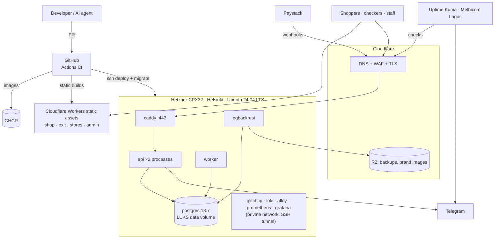

### 12.3 Docker setup

- One image for API and worker: multi-stage `apps/api/Dockerfile` (`node:24-bookworm-slim`, `pnpm deploy --prod`, non-root user, `tini`, healthcheck `curl -f localhost:4000/health/live`). Size target < 200 MB.
- `infra/compose/prod.yaml` services: `caddy`, `api` (2 replicas via `deploy.replicas` or two named services), `worker`, `postgres`, `pgbackrest` (sidecar with cron), `glitchtip`, `loki`, `alloy`, `prometheus`, `node-exporter`, `postgres-exporter`, `grafana`. Resource limits at pilot: postgres 3 GB, api 2 × 512 MB, worker 512 MB, glitchtip 512 MB, loki 512 MB, prometheus 512 MB, grafana 256 MB.
- Postgres tuning (8 GB box): `shared_buffers=2GB`, `effective_cache_size=5GB`, `work_mem=16MB`, `max_connections=100` (API pool 20 per process, worker 10), `wal_level=replica`, `archive_mode=on`, `archive_command='pgbackrest --stanza=skipa archive-push %p'`, `archive_timeout=60`.

### 12.4 CI/CD pipeline (GitHub Actions)

| Workflow | Trigger | Steps |
|---|---|---|
| `ci.yml` | PR, push | install (pnpm cache) → lint, typecheck → unit tests (Vitest) → integration tests (Postgres 18 service container) → contract check (generated OpenAPI == committed; MSW handlers validate against it) → build apps → `size-limit` → Lighthouse CI (shopper) → Playwright smoke (staging-like compose) → axe → Gitleaks, Semgrep, `pnpm audit`, Trivy |
| `deploy-staging.yml` | merge to `main` | build image `ghcr.io/<org>/skipa-api:<sha>` → push → static apps to Cloudflare (staging routes) → SSH: `docker compose pull && pnpm db:migrate && docker compose up -d` → smoke tests → Paystack sandbox E2E |
| `deploy-prod.yml` | tag `v*` + manual approval | same image (no rebuild) → backup check (WAL age < 2 min) → `db:migrate` → rolling restart (api one at a time, Caddy health-checks) → smoke → tag release in GlitchTip → Telegram "deployed v1.4.2" |
| `nightly.yml` | 01:00 WAT | full Playwright suite on staging, Paystack sandbox suite, k6 baseline, POS conformance suite, restore test of last night's backup into a scratch container |

Rollback: redeploy the previous image tag; migrations are backward-compatible by rule (expand/contract), so code rollback never requires a schema rollback. Feature flags turn new features on for one store first (17.2).

### 12.5 Server provisioning

Ansible playbook `infra/ansible/site.yml`: Ubuntu 24.04 hardening (SSH keys only, `ufw` allow 22 from admin IPs + 80/443 from Cloudflare IP ranges, unattended security upgrades, fail2ban), Docker Engine + Compose plugin, LUKS data volume at `/srv/skipa`, users, SOPS/age decrypt, Caddy config, cron for pgBackRest checks. A full rebuild of production from scratch (new server + restore) is a timed drill (target 40 min) before go-live.

### 12.6 Backups, restore drills, RPO/RTO

| Item | Setting |
|---|---|
| Tool | pgBackRest 2.x, stanza `skipa`, repository on R2 (S3-compatible), `repo1-cipher-type=aes-256-cbc` |
| WAL | Continuous archive, `archive_timeout=60s` → RPO ≈ 1 min (target 15 min, NF-04) |
| Full / differential | Full weekly (Sun 03:00 WAT), differential daily (03:00) |
| Retention | 30 days PITR; 12 monthly fulls (`repo1-retention-full-type=time`) |
| Monitoring | Alert if WAL archive age > 10 min (critical) or last backup > 26 h (high) |
| Restore drill | Nightly automated restore of the latest backup into a throwaway container + row-count checks; quarterly full manual drill to a fresh Hetzner server, timed, written up in `docs/runbooks/restore.md` (NF-04) |
| RTO (pilot, single server) | Rebuild server with Ansible (≈ 15 min) + restore (≈ 10 min for < 10 GB) + DNS stays (Cloudflare origin IP update ≈ 1 min) → ≈ 30–40 min < 1 h |
| RTO (20+ stores) | Promote the streaming replica on the second server (≈ 5 min) |

Files on the local volume (exports, POS files, dispute evidence) are synced nightly to R2 (`rclone` with crypt); exports are regenerable.

### 12.7 Availability and scaling steps

Single-server pilot availability depends on Hetzner (99.9% SLA) plus our own deploys; deploys are rolling and zero-downtime for the API; Postgres restarts only in maintenance windows (Sun 05:00–06:00 WAT, before stores open). Scaling steps are in §15.

### 12.8 Disaster recovery scenarios

| Scenario | Detection | Action | Data loss |
|---|---|---|---|
| API process crash | Docker restart, Kuma | Automatic | None |
| Server loss | Kuma critical | Rebuild + PITR restore (runbook) | ≤ 1 min |
| Postgres corruption / bad migration | Errors, alerts | PITR to before the event into a new instance; replay idempotent jobs | Point in time |
| Hetzner region outage | Kuma | Rebuild in Hetzner Falkenstein/Nuremberg (or Melbicom Lagos) from R2 backups | ≤ 1 min |
| Paystack outage | Breaker | Pay-at-till mode (NF-05); pending orders keep verifying | None |
| POS outage | Posting failures | Postings queue and retry; recon flags; store alerted | None |
| Cloudflare outage | Kuma (direct origin check) | Temporarily grey-cloud DNS to origin (Caddy serves TLS with Let's Encrypt fallback) | None |

---

## 13. Testing strategy

### 13.1 Levels

| Level | Tool | Scope | Gate |
|---|---|---|---|
| Unit | Vitest 5.1 | `packages/domain` (money, fees, flagging rules, random blocks, state machines, contrast), services with fake repos | 90% line coverage on `packages/domain` and money-path services |
| Integration | Vitest + real PostgreSQL 18 (CI service) + Fastify `inject()` | Every route: auth, validation, RLS/scope, idempotency, transitions, jobs enqueued | All routes covered; isolation suite passes |
| Contract | OpenAPI diff + Schemathesis-style fuzz (`@redocly/cli` lint + generated-property tests) + MSW handlers validated against the spec | Backend implements, frontend mocks the same file | Zero drift |
| End-to-end | Playwright 1.65 | The design prototypes P1–P8 as journeys on four apps against staging | All 17.1 scenarios green before the pilot date |
| Accessibility | `@axe-core/playwright` | Every screen | No serious/critical violations |
| Performance | Lighthouse CI, `size-limit`, k6 | Budgets §8.5; API load | Budgets met |

### 13.2 Paystack sandbox tests (nightly, test keys)

Card success, card failure (Paystack test cards), bank transfer success/pending, USSD (where the sandbox supports it), popup closed then success via webhook, redirect flow, late webhook (delay processing 15 min → receipt still issued, AC 8.5), duplicate webhook ×10 → one Paid order, invalid signature → 401 and no state change, amount mismatch → no receipt + PAY-010, double tap on Pay → one attempt, retry after failure on the same order, superseded attempt paid → stray charge flow, `transaction_charge` 0 and > 0 with `bearer: subaccount` (fee split verified in the settlement API), dispute create → evidence uploaded automatically (14.5/8.5 AC), settlement fetch and recon tie-out. Webhooks reach staging through a Cloudflare route; for local work use `paystack-cli`-style replay of recorded payloads.

### 13.3 POS connector tests

Shared conformance suite (`pnpm test:pos-conformance <connector>`): price sync, stock sync, till-only products still sync (PO-10), sale post, refund post, chargeback post, duplicate post returns the same POS reference, 2-hour outage (connector returns 503 for 2 h of simulated time) → all postings succeed once afterwards with no duplicates, malformed rows rejected with row numbers, file round trip for `generic_csv`. Run against `mock_pos` in CI and against the store's test environment before go-live (12.6).

### 13.4 Business-rule tests (from the acceptance criteria)

Every acceptance criterion in PRD 5.9, 6.6, 7.4, 8.5, 9.3, 10.4, 11.3, 12.5, 13.6, 14.5 has a named test (`ac-<section>-<n>`), e.g. random rate within 1 pp across 1,000 receipts for each of 1, 2, 5, 10, 15, 20% (property test using the block algorithm), a receipt cannot be used twice (concurrent lookups from two devices), no clearance offline, manager alert ≤ 60 s, paid-plan store never sees baseline prompts, low-contrast colour cannot be published, every export appears in the audit log.

### 13.5 Offline and low-end device tests

Playwright with `context.setOffline(true)` after check-in: scan 20 items, edit cart, outbox items queued and flushed on reconnect; CPU throttling 4× and "Slow 3G" network profile on all shopper journeys; weekly manual run on the device lab (§8.5); iOS Safari run before each release (no Background Sync path).

### 13.6 Load tests (k6)

| Scenario | Target | Pass criteria |
|---|---|---|
| Pilot day ×10 | 2 branches, 4,000 orders/day compressed into 1 h | p95 < 500 ms, 0 errors |
| Branch peak | 500 concurrent shoppers on one branch: check-in, cart sync every 30 s, 1 order/shopper/10 min, SSE connected | p95 < 500 ms; exit lookup p95 < 2 s; CPU < 70% |
| Platform claim | 10,000 concurrent SSE connections + 50 orders/s against a CPX42 test box (rented for the day, ≈ €0.20/h) | Establish the ceiling per server; feeds §15 |
| Webhook storm | 1,000 webhooks in 60 s incl. duplicates | One Paid per order; queue drains < 2 min |

Run before the pilot and before each scaling step; results recorded in `docs/perf-log.md`.

---

## 14. Cost model

Rates: $1 = ₦1,390 (CBN NFEM ₦1,382.87 on 19 Nov 2026; CBN ₦1,394.01 on 24 Nov 2026); €1 = $1.09 (CBN cross rate). Excludes VAT (Nigerian VAT of 7.5% may apply to foreign digital services) and Paystack fees (paid by stores). Volumes: pilot 400 orders/day; 20 stores ≈ 30 branches, 6,000 orders/day; 100 stores ≈ 150 branches, 30,000 orders/day.

| Line | Basis | Pilot | 20 stores | 100 stores | Source (checked 24–25 Nov 2026) |
|---|---|---|---|---|---|
| Production compute | Pilot CPX32 €30.49; 20: CPX42 €59.49 + CPX22 €16.99; 100: CPX52 €85.49 + CPX42 €59.49 + 2×CPX32 €60.98 + CPX22 €16.99 | $33.23 | $83.36 | $243.02 | hetzner.com/cloud/regular-performance (HEL1 prices) |
| Load balancer | LB11 €7.49 (100 stores) | — | — | $8.16 | hetzner.com/cloud/load-balancer |
| Watchdog | Melbicom Lagos VDS-1 €5.70 | $6.21 | $6.21 | $6.21 | melbicom.net/virtualserver/lagos |
| SMS (codes only) | 0.1 per order × ₦6.50 (₦6.00 at 100) | $5.61 | $84.17 | $388.49 | africastalking.com/pricing (₦5.50–6.00 transactional) |
| Email | Resend Free → Pro $20 (50k) → Scale $90 (100k) | $0 | $20 | $90 | resend.com/pricing |
| R2 | $0.015/GB-month after 10 GB free | ~$0.20 | ~$3 | ~$10 | developers.cloudflare.com/r2/pricing |
| Cloudflare plan | Free; Pro $25/month at 100 stores (more WAF rules) | $0 | $0 | $25 | cloudflare.com/plans |
| PostHog | 1M events free; cap; budget ceiling | $0 | $0 | ≤ $50 | posthog.com/pricing |
| GitHub Actions | $12 compute included (Free plan) | $0 | $0 | $0 | docs.github.com Actions billing |
| GlitchTip, Loki, Prometheus, Grafana, Uptime Kuma, SOPS | Self-hosted, open source | $0 | $0 | $0 | — |
| Telegram | Bot API free | $0 | $0 | $0 | — |
| Domain | Registrar-dependent (not verified) | ~$2 | ~$2 | ~$2 | — |
| **Total** | | **≈ $47 / ₦66,000** | **≈ $199 / ₦276,000** | **≈ $823 / ₦1.14M** | |

(100-store compute shown split: $243.02 servers + $8.16 LB = $251.18, matching §1.3.)

**Not in the run cost:** staging server $18.52/month (can be stopped), penetration test (quote needed), legal review, devices for the test lab, Paystack fees (stores), chargeback reserve float (Skipa's own funds, recoverable).

**Cost-saving switches available:** email → Amazon SES at 100 stores (−≈ $80); PostHog off → Metabase on own data (−$50); SMS → push notifications in Phase 3 for returning sign-ins (codes only remain for new devices); stop staging between test cycles; Cloudflare Pro only if WAF rules are needed.

**Accepted risks of the cheaper choices (owner decisions):** single-server pilot (RTO ≈ 30–40 min, observability offline with the server), self-hosted observability upkeep, SOPS instead of a secrets service, Resend free daily cap (receipts can be held until morning), EU hosting needing a transfer basis.

---

## 15. Scaling and Phase 3 path

| Trigger (measured) | Step | Cost delta |
|---|---|---|
| 10+ stores, or CPU > 60% at peak for a week, or any restore drill > 30 min | Move observability to a second server (CPX22) which also runs a Postgres **streaming replica** (hot standby, promotion runbook) | +$18.52 |
| 20 stores or DB CPU > 60% | Resize primary to CPX42; API and worker processes up to 4/2 | (in the 20-store column) |
| p95 > 400 ms at peak, or > 3,000 concurrent SSE connections per server | Split app and DB: 2 × app servers (CPX32) behind Hetzner LB11; Postgres on its own server (CPX52); replica on CPX42 | (in the 100-store column) |
| DB CPU steal > 10% or I/O wait | Move DB to dedicated vCPU (CCX33, €117.99) | +$95 |
| Queue > 500 jobs/s or analytics writes > 30% of DB load | Move `analytics.events` and pg-boss to a second Postgres; or analytics to ClickHouse | +$20–60 |
| > 10,000 SSE connections | Run Centrifugo (open source) as the real-time gateway, fed from NOTIFY | +$18 |
| Multi-region resilience required by contracts | Warm standby in Hetzner Falkenstein (pgBackRest restore every hour) or a Lagos provider | +$40–80 |
| Dashboards slow on large ranges | Nightly rollup tables per branch/day (materialised views refreshed by a job) | $0 |

**Phase 3 (native apps and wallet), without rewriting the backend**

- **Apps:** Expo (React Native) app `apps/mobile` using `packages/api-client`, `packages/contracts`, `packages/analytics` (same event names, AN-04) and `packages/tokens/dist/tokens.ts`. Auth uses `Authorization: Bearer` with the same OTP endpoints and device tokens (NF-24). Store branding uses the same `BrandTokens` (BR-10). The web app stays for first-time shoppers.
- **Push notifications:** a new `push` channel in the notifications module (Expo push service; device push tokens table); replaces most email/SMS for app users.
- **Wallet (WL-01–10):** a `wallet` module integrating a licensed partner's API: wallet top-up confirmation by the partner (like Paystack verify), wallet as a new `channel` on `payment_attempts`, PIN/biometric confirmation in the app, refunds-to-wallet only via the partner (Skipa still holds no money), wallet totals in admin, wallet lines in reconciliation (WL-09) and `WALLET-*` error codes. No change to orders, receipts, exit or POS modules.
- **Referrals and promotions (Phase 2):** `referrals` and `promotions` modules; discounts become order adjustments (`order_discounts` table) applied at order creation; RF-01–07 events already reserved.
- **Versioning:** `/v1` supports clients ≥ 6 months old (NF-25); minimum client version enforced via `X-Skipa-Client` and `SYS-426`.

---

## 16. Delivery plan (Phase 0: build MVP)

Assumes 2 engineers (one backend-leaning, one frontend-leaning) plus AI agents, 2-week sprints. Dates are relative (the pilot date is set only when staging passes 17.1, per 17.3).

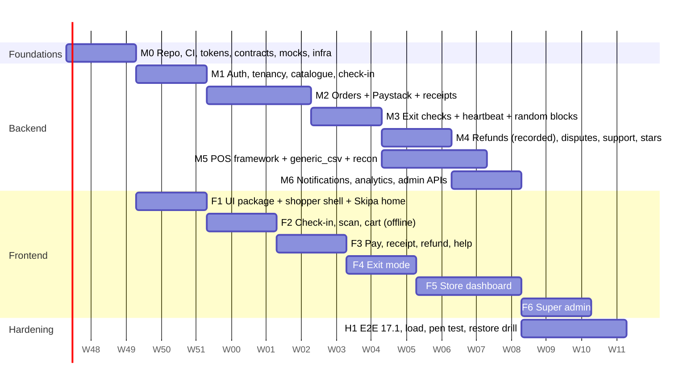

| Milestone | Backend | Frontend (against MSW mocks until the backend lands) | Done when |
|---|---|---|---|
| M0 Foundations (wk 1–2) | Monorepo, CI, Postgres + migrations from `schema.sql`, seed, error/idempotency/request-ID plumbing, OpenAPI published | Tokens pipeline, `packages/ui` core components, MSW mocks from the contract, four app shells | CI green; mocks serve every endpoint |
| M1 (wk 3–4) | Auth (OTP, sessions, invites), tenancy, catalogue import (file mode), check-in, catalogue snapshot | Skipa home, stores search, check-in, registration/sign-in, tours | SH-01–08, SH-25–31 demoable on staging |
| M2 (wk 5–7) | Orders, Paystack initialise/webhook/verify/sweep, receipts, exit tokens, SSE | Scanner + offline cart, pay flow, confirming/pending, receipt | Paystack sandbox suite green (8.5 AC) |
| M3 (wk 8–9) | Exit plans, random blocks, lookup/complete/weight, heartbeat + EXIT-004 | Exit mode (phone + tablet) | 6.6 AC green |
| M4 (wk 10–11) | Refunds (recorded), disputes + evidence, support tickets, chatbot, stars | Refund request/status, help chat, Support tab | 8.5, 9.3 AC green |
| M5 (wk 10–12, parallel) | POS framework, `generic_csv`, `mock_pos`, API connector (when known), settlements, recon, payout reports, billing | Reconciliation screens | 12.5 AC green |
| M6 (wk 12–13) | Notifications (email budget, Telegram, SMS failover), analytics ingest + reports, admin APIs, exports, privacy jobs | Store dashboard complete, super admin | 10.4, 11.3, 13.6, 14.5 AC green |
| H1 (wk 14–16) | Load tests, pen test fixes, restore drill, runbooks | Device-lab runs, accessibility fixes | All 17.1 scenarios pass in staging with the pilot POS test data → set pilot date |

Dependencies: frontend never waits for backend (mocks), but each frontend milestone switches from mocks to staging in the following sprint; the POS API connector depends on the pilot store's POS details (open); dispute evidence depends on Paystack sandbox confirmation of field names.

---

## 17. Decision records, risks and open questions

### 17.1 Architecture decision records

Format: **Context · Options · Decision · Consequences · Revisit when.**

| ADR | Context | Options | Decision | Consequences | Revisit when |
|---|---|---|---|---|---|
| ADR-01 Language & repo | Tiny team; web now, native later; shared types | TS monorepo; Python + TS; Go | TypeScript monorepo (pnpm, Turborepo), Node 24 LTS | One language; contracts shared; single toolchain | CPU-bound hot path appears |
| ADR-02 Backend framework | API, webhooks, jobs, SSE | NestJS; Fastify; Hono | Fastify 5 | Less boilerplate, Zod-native; structure via module template | Team > 5 backend devs or Nest-only hires |
| ADR-03 API contract | Parallel FE/BE work; native later | REST+OpenAPI; tRPC; GraphQL | REST `/v1` + OpenAPI 3.1 from Zod; generated clients | Any client can integrate; contract PR process | Never (versioned) |
| ADR-04 Database | Money needs consistency; small ops budget | Self-hosted PG; managed PG; MySQL | Self-hosted PostgreSQL 18 (data, queue, notify, search) | Fewer services; we own backups | Ops > 4 h/month or HA automation needed |
| ADR-05 ORM | Typed queries + raw SQL for ledgers | Drizzle; Prisma; Kysely | Drizzle + reviewed SQL migrations | Light; pre-1.0 risk | Breaking Drizzle release |
| ADR-06 Jobs | Retries, schedules, transactional enqueue | pg-boss; Graphile Worker; BullMQ | pg-boss | No Redis; atomic outbox | Throughput limits |
| ADR-07 Real-time | ≤ 5 s updates; one-way | SSE+NOTIFY; WebSockets; hosted | SSE + NOTIFY + polling fallback | Simple, CF-friendly | > 10k connections/node |
| ADR-08 Web framework | < 500 KB, shared UI | React+Vite; Preact; SvelteKit; Next.js | React 19 + Vite 8 (Preact alias as fallback) | One component library | Budget exceeded on reference device |
| ADR-09 State/forms | Server state, offline | TanStack Query/Router + RHF; alternatives | As chosen | Typed, cache-aware | — |
| ADR-10 Scanner | Fast on cheap phones, iOS too | Native+zxing-wasm; html5-qrcode; commercial | Native + `barcode-detector` polyfill | $0; WASM lazy-loaded on iOS | < 95% first-try scans |
| ADR-11 Offline | Catalogue + outbox | Workbox + Dexie; hand-rolled | Workbox + Dexie; no exit queue (D-16) | Robust offline scanning | — |
| ADR-12 UI tokens | One source for design updates | Tailwind+tokens; CSS vars + headless; shadcn | `tokens.css` → Tailwind 4 `@theme` + Radix | Design update = one file | — |
| ADR-13 Charts | Dashboards only | Recharts; ECharts; uPlot | Recharts (lazy) | Easy React charts | > 10k points |
| ADR-14 Auth | OTP for all; MFA flag for super admin | In-house; Supabase; Clerk; Firebase | In-house sessions + OTP; TOTP behind flag | $0; we own auth risk → pen test | Auth incidents; SSO need |
| ADR-15 Hosting | Budget hosting that works well (AD-13) | Hetzner; Melbicom Lagos; DO; Render; AWS Lagos | Hetzner Helsinki shared vCPU, single server at pilot, Docker Compose + Caddy + Ansible | Cheap, reliable; EU transfer basis needed; single-server risk accepted | Latency or SLA trigger (§4) |
| ADR-16 Edge | DNS, TLS, WAF, static | Cloudflare; Vercel; Netlify | Cloudflare Free + Workers static assets | $0; API transit via CF (DPIA) | Need Pro WAF |
| ADR-17 Object storage | Images, backups | R2; B2; S3 | R2 | Free egress | > 2 TB |
| ADR-18 Backups | RPO 15 min, RTO 1 h | pgBackRest; WAL-G; managed | pgBackRest to R2, encrypted; replica from 10–20 stores | RPO ≈ 1 min; drills required | — |
| ADR-19 SMS | Shopper codes only (AD-03) | Africa's Talking; Termii | AT primary, Termii failover | Reliable delivery | Delivery < 95% |
| ADR-20 Email | Codes, receipts, alerts on email | Resend; Brevo; SES | Resend Free (AD-14) with budget guard | Receipts may be held to next morning | Holds 3 days/week → Pro; > 50k/month → SES |
| ADR-21 Platform alerts | Founders on phones | Telegram; Slack; SMS | Telegram + in-app; email fallback (AD-05) | $0 | — |
| ADR-22 Analytics | Funnels; store reports from DB | PostHog Cloud; self-hosted; own table | Own table + capped PostHog EU | Reports exact (AN-10) | Cost > $50 or legal objection |
| ADR-23 Errors | Request IDs, releases | Sentry; GlitchTip self-hosted | Sentry SDK → GlitchTip | $0; upkeep | Need tracing/replay |
| ADR-24 Logs/metrics/uptime | 90-day logs; external uptime | Grafana Cloud; Better Stack; self-hosted | Self-hosted LGTM-lite + Kuma in Lagos | $0; upkeep | Upkeep > 2 h/month |
| ADR-25 Secrets | Keys out of code | Infisical; Doppler; SOPS | SOPS + age | No audit trail of reads | > 3 people / audit need |
| ADR-26 CI/CD | Tests, builds, deploys | GitHub Actions; GitLab | GitHub Actions + GHCR | $0 at our volume | Minutes exhausted |
| ADR-27 Testing | Money correctness, offline, load | Vitest/Playwright/k6; Jest/Cypress | Vitest, Playwright, k6, MSW | Fast feedback | — |
| ADR-28 Mobile | Phase 3 reuse | Expo; Flutter; native | Expo | Shared contracts/client/tokens | — |
| ADR-29 Paystack model | Skipa never holds money (AD-06, AD-07) | Split + subaccount; store's own account + invoice | Split, store subaccount, `bearer: subaccount`, Skipa fee via `transaction_charge`; refunds recorded off-platform; no fee reversal (AD-08) | Store pays Paystack fees; refunds outside Skipa; chargebacks debit Skipa → reserve + receivables (AD-09) | Paystack allows chargeback debits to subaccount → remove reserve |
| ADR-30 Random checks | 1 pp accuracy AC; unpredictability | Bernoulli draw; stratified shuffled blocks | Stratified blocks (k = 2–6 per block) | Meets AC (≤ 0.5 pp simulated); block exhaustion theoretically inferable by insiders who track every basket — mitigated by other rules and signals | Audit finds patterning |
| ADR-31 Exit tokens | Single-use, unforgeable, no data in QR (D-16) | JWT; random opaque ID; Ed25519 compact token | Ed25519 compact token carrying only jti/branch/exp | Small QR; offline verification not needed | — |

### 17.2 Risks

| Risk | Impact | Likelihood | Mitigation | Owner |
|---|---|---|---|---|
| Lost chargebacks debit Skipa's Paystack payouts | Skipa fronts store money | Medium | Reserve + receivables (AD-09); strong automatic evidence within 16 h; ask Paystack about subaccount debits | Founder |
| Paystack split behaviour differs from docs (`transaction_charge: 0`, bearer with 0%) | Wrong fees, reconciliation noise | Medium | Sandbox tests in M2 before any store goes live | Backend |
| Pilot POS has no usable API | Manual work, slower price sync | Medium | File mode built first; ask for POS details before signing (12.6) | Founder |
| Resend daily cap holds receipts | Shoppers get receipt emails next morning | Medium | App receipt always available; reserve for codes; upgrade trigger | Backend |
| Single server failure during trading | 30–40 min outage; pay at till | Low | Hetzner SLA, PITR, rebuild drill, replica from 10–20 stores | Founder |
| Exit point loses connection | Queue at exit | Medium | Backup SIM/Wi-Fi advice (NF-26), 60 s manager alert, receipt lookup on dashboard | Store |
| Super admin email takeover | Full platform exposure | Low | Mailbox MFA, new-device notices, TOTP flag before second admin, audit | Founder |
| Cross-border transfer not cleared by counsel | Legal exposure | Medium | DPIA, DPAs, SCC-style clauses; fallback to a Nigerian host using the same scripts | Founder |
| Low-end phones struggle with camera scanning | Adoption | Medium | Native detector, manual entry, device lab, commercial SDK trigger | Frontend |
| AI-generated code bugs on money paths | Financial errors | Medium | CODEOWNERS, human review, AC test suite, invariant alerts | Lead |
| SMS pumping on sign-in codes | Cost spike | Low | +234 only, limits, Turnstile, spend alarm | Backend |
| Refund records not entered by stores | Reconciliation noise, unhappy shoppers | Medium | Reminders 24/48 h, recon cause `refund_not_recorded`, head office visibility | Store |

### 17.3 Open questions

| # | Question | Needed by | Default if unanswered |
|---|---|---|---|
| 1 | Paystack: can lost chargebacks on split transactions be debited from the subaccount? | Go-live | Reserve + receivables (AD-09) |
| 2 | Paystack: confirm `transaction_charge: 0` with `bearer: subaccount`, dispute evidence field names, settlement API filters, webhook source IPs | M2 | Sandbox findings |
| 3 | Pilot stores' POS names, versions, API access, test environment, technical contact (12.6) | M5 | File mode for both |
| 4 | Domains (`skipa.ng`?) and email sending domain | M0 | `skipa.ng` placeholders |
| 5 | Legal: NDPA transfer basis for EU hosting, retention of financial records (7 years?), breach notification timing, data-request timeframe (Q23) | Before go-live | As §7.6, §11.5 |
| 6 | How Skipa recovers lost-chargeback receivables from stores (invoice assumed) | Paid stores | Monthly invoice |
| 7 | Dashboard name menu design (SD-22) | Sprint 1 | Simple menu built from existing components |
| 8 | Q17, Q18, Q19, Q22, Q25 (open design questions) | Before pilot | Design-proposed answers |
| 9 | Exit checker email addresses for staff without work email (AD-04) | Onboarding | Personal email entered by the admin |
| 10 | Penetration test vendor and budget | H1 | Quote two Lagos vendors |

---

## Appendix A — Endpoint index

Generated from `api/openapi.v1.yaml` (request and response shapes are in that file). "Idem." = `Idempotency-Key` required.

| Method | Path | Area | Auth | Idem. | PRD |
|---|---|---|---|---|---|
| GET | `/health/live` | System | public |  | NF-01 |
| GET | `/health/ready` | System | public |  | ER-09 |
| POST | `/v1/devices` | Identity | public |  | IR-06, SH-05 |
| POST | `/v1/auth/otp` | Auth | device token |  | RB-02, SH-06, SH-08, NF-11 |
| POST | `/v1/auth/otp/verify` | Auth | device token |  | RB-02, RB-06, SA-01, AUTH-003 |
| POST | `/v1/auth/register` | Auth | device token |  | SH-06, SH-07, NF-15, ST-07 |
| POST | `/v1/auth/second-step` | Auth | super_admin (support_agent read-only where GET) |  | SA-01, D-23 |
| POST | `/v1/auth/second-step/enrol` | Auth | super_admin (support_agent read-only where GET) |  | SA-01 |
| GET | `/v1/auth/invites/{token}` | Auth | public |  | RB-03, NF-28 |
| GET | `/v1/auth/session` | Auth | device, shopper or staff |  | RB-01 |
| POST | `/v1/auth/sign-out` | Auth | device, shopper or staff |  | RB-06 |
| POST | `/v1/auth/hand-over` | Auth | exit_checker session bound to a branch |  | RB-06, EX-06 |
| GET | `/v1/auth/sessions` | Auth | any staff session |  | SD-22 |
| DELETE | `/v1/auth/sessions/{sessionId}` | Auth | any staff session |  | SD-22 |
| GET | `/v1/stores` | Discovery | device token |  | SH-26, D-11, NF-29 |
| GET | `/v1/branches/{branchId}` | Discovery | device token |  | SH-26, BR-01, BR-07 |
| POST | `/v1/check-ins` | Shopping | guest device token or shopper session |  | SH-01, SH-02, NF-05 |
| GET | `/v1/branches/{branchId}/catalogue` | Shopping | guest device token or shopper session |  | SH-10, SH-11, SH-12, PO-01 |
| PUT | `/v1/sessions/{sessionId}/cart` | Shopping | guest device token or shopper session |  | SH-14, SH-15, SH-16, CART-004 |
| POST | `/v1/sessions/{sessionId}/unknown-barcodes` | Shopping | guest device token or shopper session |  | SH-12, SH-13 |
| POST | `/v1/sessions/{sessionId}/end` | Shopping | guest device token or shopper session |  | SH-03 |
| POST | `/v1/orders` | Payments | guest device token or shopper session | yes | PY-01, SH-16, CS-01, CS-03 |
| GET | `/v1/orders/{orderId}` | Payments | guest device token or shopper session |  | SH-18, SH-19, HP-04 |
| POST | `/v1/orders/{orderId}/payment-attempts` | Payments | guest device token or shopper session | yes | SH-17, PY-01, PY-12 |
| POST | `/v1/orders/{orderId}/verify` | Payments | guest device token or shopper session |  | PY-02, PY-03 |
| GET | `/v1/payments/return` | Payments | public |  | SH-17, Q09 |
| POST | `/v1/webhooks/paystack` | Webhooks | Paystack signature |  | PY-02, PY-04, PY-09, NF-09 |
| GET | `/v1/receipts/{receiptId}` | Receipts | guest device token or shopper session |  | SH-20, SH-23, PY-06 |
| GET | `/v1/me/receipts` | Receipts | guest device token or shopper session |  | SH-21, SH-30 |
| POST | `/v1/receipts/{receiptId}/email` | Receipts | guest device token or shopper session | yes | SH-21, NT-06 |
| POST | `/v1/receipts/{receiptId}/rating` | Receipts | guest device token or shopper session |  | SH-24 |
| POST | `/v1/receipts/{receiptId}/refund-requests` | Refunds | guest device token or shopper session | yes | SH-22, SH-32, PY-07, NT-02 |
| GET | `/v1/me/refunds/{refundId}` | Refunds | guest device token or shopper session |  | SH-32 |
| GET | `/v1/help/faqs` | Help | device token |  | HP-01, HP-02, HP-03, HP-15 |
| POST | `/v1/help/match` | Help | device token |  | HP-01, HP-04, HP-05 |
| POST | `/v1/support/tickets` | Support | guest device token or shopper session | yes | HP-07, HP-08, HP-09, NT-02 |
| GET | `/v1/me/support/tickets` | Support | guest device token or shopper session |  | SH-27, D-12 |
| GET | `/v1/support/tickets/{ticketId}/messages` | Support | device, shopper or staff |  | HP-11 |
| POST | `/v1/support/tickets/{ticketId}/messages` | Support | device, shopper or staff | yes | HP-11 |
| POST | `/v1/support/tickets/{ticketId}/rating` | Support | guest device token or shopper session |  | HP-14 |
| GET | `/v1/me` | Account | registered shopper session |  | SH-28, ST-08 |
| PATCH | `/v1/me` | Account | registered shopper session |  | SH-07, SH-29 |
| GET | `/v1/me/stars` | Account | registered shopper session |  | ST-04, ST-08 |
| GET | `/v1/me/visited-stores` | Account | registered shopper session |  | SH-30, D-14 |
| POST | `/v1/me/data-requests` | Account | registered shopper session |  | NF-16 |
| GET | `/v1/me/data-requests` | Account | registered shopper session |  | NF-16 |
| PUT | `/v1/tours/{tourKey}` | Account | device, shopper or staff |  | SH-31, SD-21, EX-12 |
| POST | `/v1/events` | Analytics | device token |  | AN-01, AN-02, AN-03 |
| POST | `/v1/monitoring/tunnel` | Monitoring | public |  | ER-01, ER-02 |
| GET | `/v1/stream` | Realtime | device, shopper or staff |  | SD-01, EX-10, SA-02 |
| POST | `/v1/exit/lookups` | Exit | exit_checker session bound to a branch | yes | EX-01, EX-02, EX-03, EX-07, SH-23, CS-02 |
| POST | `/v1/exit/checks/{checkId}/weight` | Exit | exit_checker session bound to a branch |  | EX-04, EX-05 |
| POST | `/v1/exit/checks/{checkId}/complete` | Exit | exit_checker session bound to a branch | yes | EX-06, 6.5 |
| POST | `/v1/exit/heartbeat` | Exit | exit_checker session bound to a branch |  | NF-26, EX-10 |
| GET | `/v1/exit/shift-summary` | Exit | exit_checker session bound to a branch |  | EX-06 |
| GET | `/v1/store/live` | Store · Live | store_manager or head_office_admin (branch-scoped) |  | SD-01, SD-04 |
| GET | `/v1/store/alerts` | Store · Live | store_manager or head_office_admin (branch-scoped) |  | SD-01, 9 |
| POST | `/v1/store/alerts/{alertId}/acknowledge` | Store · Live | store_manager or head_office_admin (branch-scoped) |  | 9 |
| GET | `/v1/store/receipts` | Store · Receipts | store_manager or head_office_admin (branch-scoped) |  | SD-05, 10.1 |
| GET | `/v1/store/receipts/{receiptId}` | Store · Receipts | store_manager or head_office_admin (branch-scoped) |  | SD-02, CS-01 |
| GET | `/v1/store/exit-checks` | Store · Exit | store_manager or head_office_admin (branch-scoped) |  | EX-06, SD-05 |
| GET | `/v1/store/exit-checks/signals` | Store · Exit | store_manager or head_office_admin (branch-scoped) |  | EX-08 |
| GET | `/v1/store/refunds` | Store · Refunds | store_manager or head_office_admin (branch-scoped) |  | PY-07, PY-08 |
| POST | `/v1/store/refunds` | Store · Refunds | store_manager or head_office_admin (branch-scoped) | yes | PY-07, HP-11 |
| POST | `/v1/store/refunds/{refundId}/approve` | Store · Refunds | store_manager or head_office_admin (branch-scoped) | yes | PY-07, PY-08, RB-04 |
| POST | `/v1/store/refunds/{refundId}/decline` | Store · Refunds | store_manager or head_office_admin (branch-scoped) | yes | PY-07, RB-04 |
| POST | `/v1/store/refunds/{refundId}/payment` | Store · Refunds | store_manager or head_office_admin (branch-scoped) | yes | PY-07, PY-10, ST-06, RB-04 |
| GET | `/v1/store/disputes` | Store · Refunds | store_manager or head_office_admin (branch-scoped) |  | PY-09 |
| GET | `/v1/store/support/tickets` | Store · Support | store_manager or head_office_admin (branch-scoped) |  | HP-10, HP-12 |
| GET | `/v1/store/support/tickets/{ticketId}` | Store · Support | store_manager or head_office_admin (branch-scoped) |  | HP-08 |
| PATCH | `/v1/store/support/tickets/{ticketId}` | Store · Support | store_manager or head_office_admin (branch-scoped) |  | HP-11 |
| POST | `/v1/store/support/tickets/{ticketId}/escalate` | Store · Support | store_manager or head_office_admin (branch-scoped) |  | HP-13 |
| GET | `/v1/store/faqs` | Store · Support | store_manager or head_office_admin (branch-scoped) |  | HP-02 |
| POST | `/v1/store/faqs` | Store · Support | store_manager or head_office_admin (branch-scoped) |  | HP-02 |
| PUT | `/v1/store/faqs/{faqId}` | Store · Support | store_manager or head_office_admin (branch-scoped) |  | HP-02 |
| DELETE | `/v1/store/faqs/{faqId}` | Store · Support | store_manager or head_office_admin (branch-scoped) |  | HP-02 |
| GET | `/v1/store/categories` | Store · Catalogue | store_manager or head_office_admin (branch-scoped) |  | CT-01, CT-06 |
| POST | `/v1/store/categories` | Store · Catalogue | store_manager or head_office_admin (branch-scoped) |  | CT-02, CT-03 |
| PATCH | `/v1/store/categories/{categoryId}` | Store · Catalogue | store_manager or head_office_admin (branch-scoped) |  | CT-02, CT-03, CT-09 |
| PUT | `/v1/store/branches/{branchId}/categories/{categoryId}` | Store · Catalogue | store_manager or head_office_admin (branch-scoped) |  | CT-01, CT-08, CT-09 |
| GET | `/v1/store/products` | Store · Catalogue | store_manager or head_office_admin (branch-scoped) |  | CT-04, CT-06, PO-10 |
| PATCH | `/v1/store/products/{productId}` | Store · Catalogue | store_manager or head_office_admin (branch-scoped) |  | CT-04, CT-07, CT-09 |
| POST | `/v1/store/products/weights-import` | Store · Catalogue | store_manager or head_office_admin (branch-scoped) |  | CT-07 |
| POST | `/v1/store/baselines` | Store · Catalogue | store_manager or head_office_admin (branch-scoped) |  | CT-08, D-21 |
| POST | `/v1/store/loss-counts` | Store · Catalogue | store_manager or head_office_admin (branch-scoped) |  | SD-07, 2.4 |
| GET | `/v1/store/staff` | Store · Staff | store_manager or head_office_admin (branch-scoped) |  | RB-01, RB-03 |
| POST | `/v1/store/staff/invites` | Store · Staff | store_manager or head_office_admin (branch-scoped) | yes | RB-03, 3.2, NF-28 |
| POST | `/v1/store/staff/{userId}/invite/resend` | Store · Staff | store_manager or head_office_admin (branch-scoped) |  | RB-03 |
| DELETE | `/v1/store/staff/{userId}/invite` | Store · Staff | store_manager or head_office_admin (branch-scoped) |  | RB-03 |
| PATCH | `/v1/store/staff/{userId}` | Store · Staff | store_manager or head_office_admin (branch-scoped) |  | RB-03, RB-04 |
| DELETE | `/v1/store/staff/{userId}` | Store · Staff | store_manager or head_office_admin (branch-scoped) |  | RB-03 |
| GET | `/v1/store/branches/{branchId}/settings` | Store · Settings | store_manager or head_office_admin (branch-scoped) |  | CS-06, SD-23 |
| PATCH | `/v1/store/branches/{branchId}/settings` | Store · Settings | store_manager or head_office_admin (branch-scoped) |  | EX-11, PY-11, RB-04 |
| POST | `/v1/store/branches/{branchId}/switch-off` | Store · Settings | store_manager or head_office_admin (branch-scoped) | yes | SD-03 |
| POST | `/v1/store/branches/{branchId}/switch-on` | Store · Settings | store_manager or head_office_admin (branch-scoped) | yes | SD-03 |
| GET | `/v1/store/branches/{branchId}/qr-codes` | Store · Settings | store_manager or head_office_admin (branch-scoped) |  | SD-08 |
| POST | `/v1/store/branches/{branchId}/qr-codes` | Store · Settings | store_manager or head_office_admin (branch-scoped) |  | SD-08 |
| GET | `/v1/store/qr-codes/{qrCodeId}/sign.pdf` | Store · Settings | store_manager or head_office_admin (branch-scoped) |  | SD-08, BR-01 |
| GET | `/v1/me/notification-preferences` | Store · Settings | any staff session |  | NT-04 |
| PUT | `/v1/me/notification-preferences` | Store · Settings | any staff session |  | NT-04 |
| GET | `/v1/store/branding` | Store · Branding | store_manager or head_office_admin (branch-scoped) |  | BR-01..09 |
| PUT | `/v1/store/branding/draft` | Store · Branding | store_manager or head_office_admin (branch-scoped) |  | BR-02, BR-04 |
| POST | `/v1/store/branding/assets` | Store · Branding | store_manager or head_office_admin (branch-scoped) |  | BR-05 |
| POST | `/v1/store/branding/publish` | Store · Branding | store_manager or head_office_admin (branch-scoped) | yes | BR-03, BR-04, BR-09 |
| POST | `/v1/store/branding/versions/{versionId}/restore` | Store · Branding | store_manager or head_office_admin (branch-scoped) |  | BR-03 |
| GET | `/v1/store/reconciliation/days` | Store · Reconciliation | store_manager or head_office_admin (branch-scoped) |  | PO-07 |
| GET | `/v1/store/reconciliation/items` | Store · Reconciliation | store_manager or head_office_admin (branch-scoped) |  | PO-07 |
| POST | `/v1/store/reconciliation/items/{itemId}/resolve` | Store · Reconciliation | store_manager or head_office_admin (branch-scoped) |  | 12.4, RB-04 |
| POST | `/v1/store/reconciliation/items/{itemId}/retry` | Store · Reconciliation | store_manager or head_office_admin (branch-scoped) |  | PO-05 |
| GET | `/v1/store/payouts/{date}` | Store · Reconciliation | store_manager or head_office_admin (branch-scoped) |  | PO-08, PY-13 |
| GET | `/v1/store/shift-close/{date}` | Store · Reconciliation | store_manager or head_office_admin (branch-scoped) |  | PO-06 |
| GET | `/v1/store/pos/health` | Store · Reconciliation | store_manager or head_office_admin (branch-scoped) |  | PO-09 |
| GET | `/v1/store/pos/files` | Store · Reconciliation | store_manager or head_office_admin (branch-scoped) |  | 12.1 |
| POST | `/v1/store/pos/files` | Store · Reconciliation | store_manager or head_office_admin (branch-scoped) |  | 12.1, PO-02 |
| POST | `/v1/store/pos/files/{fileId}/confirm` | Store · Reconciliation | store_manager or head_office_admin (branch-scoped) |  | PO-03 |
| GET | `/v1/store/analytics/{report}` | Store · Analytics | store_manager or head_office_admin (branch-scoped) |  | 13.3, AN-08, AN-09, AN-10 |
| GET | `/v1/store/loss-report` | Store · Analytics | store_manager or head_office_admin (branch-scoped) |  | SD-07, D-21 |
| GET | `/v1/store/shoppers` | Store · Analytics | store_manager or head_office_admin (branch-scoped) |  | ST-09, Q12 |
| POST | `/v1/store/exports` | Store · Data | store_manager or head_office_admin (branch-scoped) | yes | SD-05 |
| GET | `/v1/store/exports/{exportId}` | Store · Data | store_manager or head_office_admin (branch-scoped) |  | SD-05 |
| GET | `/v1/store/audit-log` | Store · Data | store_manager or head_office_admin (branch-scoped) |  | RB-07, SD-20 |
| GET | `/v1/store/admin-access-log` | Store · Data | store_manager or head_office_admin (branch-scoped) |  | RB-05, RB-07 |
| GET | `/v1/store/data-requests` | Store · Data | store_manager or head_office_admin (branch-scoped) |  | NF-16 |
| GET | `/v1/admin/overview` | Admin | super_admin (support_agent read-only where GET) |  | SA-02, SA-06 |
| GET | `/v1/admin/alerts` | Admin | super_admin (support_agent read-only where GET) |  | 14.4 |
| POST | `/v1/admin/alerts/{alertId}/acknowledge` | Admin | super_admin (support_agent read-only where GET) |  | 14.4 |
| GET | `/v1/admin/organisations` | Admin | super_admin (support_agent read-only where GET) |  | 11.1 |
| POST | `/v1/admin/organisations` | Admin | super_admin (support_agent read-only where GET) | yes | 11.1 |
| GET | `/v1/admin/organisations/{organisationId}` | Admin | super_admin (support_agent read-only where GET) |  | 11.1, PO-09 |
| PATCH | `/v1/admin/organisations/{organisationId}` | Admin | super_admin (support_agent read-only where GET) |  | 11.1, RB-04 |
| POST | `/v1/admin/organisations/{organisationId}/plan` | Admin | super_admin (support_agent read-only where GET) |  | SA-09, CS-07 |
| POST | `/v1/admin/organisations/{organisationId}/subaccount` | Admin | super_admin (support_agent read-only where GET) | yes | PY-12 |
| POST | `/v1/admin/organisations/{organisationId}/branches` | Admin | super_admin (support_agent read-only where GET) |  | 11.1 |
| GET | `/v1/admin/organisations/{organisationId}/onboarding` | Admin | super_admin (support_agent read-only where GET) |  | 11.1 |
| PUT | `/v1/admin/organisations/{organisationId}/onboarding/{stepKey}` | Admin | super_admin (support_agent read-only where GET) |  | 11.1 |
| POST | `/v1/admin/organisations/{organisationId}/pos-connection` | Admin | super_admin (support_agent read-only where GET) |  | 12.1, 12.6 |
| POST | `/v1/admin/personal-data-access` | Admin | super_admin (support_agent read-only where GET) |  | RB-05, SA-01 |
| GET | `/v1/admin/shoppers` | Admin | super_admin (support_agent read-only where GET) |  | 11.1, RB-05 |
| GET | `/v1/admin/shoppers/{shopperId}` | Admin | super_admin (support_agent read-only where GET) |  | RB-05 |
| POST | `/v1/admin/shoppers/{shopperId}/suspend` | Admin | super_admin (support_agent read-only where GET) |  | 11.1 |
| GET | `/v1/admin/transactions` | Admin | super_admin (support_agent read-only where GET) |  | 11.1 |
| GET | `/v1/admin/orders/{orderId}/trace` | Admin | super_admin (support_agent read-only where GET) |  | 11.3, SA-06 |
| GET | `/v1/admin/disputes` | Admin | super_admin (support_agent read-only where GET) |  | PY-09, 11.1 |
| POST | `/v1/admin/disputes/{disputeId}/evidence` | Admin | super_admin (support_agent read-only where GET) | yes | PY-09 |
| GET | `/v1/admin/reconciliation` | Admin | super_admin (support_agent read-only where GET) |  | 11.1, PO-07 |
| GET | `/v1/admin/billing` | Admin | super_admin (support_agent read-only where GET) |  | SA-08, PY-13 |
| GET | `/v1/admin/chargeback-reserve` | Admin | super_admin (support_agent read-only where GET) |  | Decision 2026-11-24 |
| POST | `/v1/admin/chargeback-reserve/entries` | Admin | super_admin (support_agent read-only where GET) |  | CS-04 |
| GET | `/v1/admin/receivables` | Admin | super_admin (support_agent read-only where GET) |  | 8.4 |
| GET | `/v1/admin/analytics/{report}` | Admin | super_admin (support_agent read-only where GET) |  | 13.4 |
| GET | `/v1/admin/errors` | Admin | super_admin (support_agent read-only where GET) |  | ER-11 |
| GET | `/v1/admin/health` | Admin | super_admin (support_agent read-only where GET) |  | ER-09 |
| GET | `/v1/admin/feature-flags` | Admin | super_admin (support_agent read-only where GET) |  | SA-04 |
| PATCH | `/v1/admin/feature-flags/{flagKey}` | Admin | super_admin (support_agent read-only where GET) |  | SA-04, D-23 |
| GET | `/v1/admin/settings` | Admin | super_admin (support_agent read-only where GET) |  | 11.1 |
| PATCH | `/v1/admin/settings` | Admin | super_admin (support_agent read-only where GET) |  | CS-06 |
| GET | `/v1/admin/standard-categories` | Admin | super_admin (support_agent read-only where GET) |  | 7.2 |
| POST | `/v1/admin/standard-categories` | Admin | super_admin (support_agent read-only where GET) |  | 7.2 |
| GET | `/v1/admin/templates` | Admin | super_admin (support_agent read-only where GET) |  | NT-03 |
| PUT | `/v1/admin/templates/{templateKey}/{channel}` | Admin | super_admin (support_agent read-only where GET) |  | NT-03 |
| GET | `/v1/admin/loyalty` | Admin | super_admin (support_agent read-only where GET) |  | ST-02, ST-03, ST-10 |
| PUT | `/v1/admin/loyalty` | Admin | super_admin (support_agent read-only where GET) |  | ST-02 |
| GET | `/v1/admin/users` | Admin | super_admin (support_agent read-only where GET) |  | 11.1 |
| GET | `/v1/admin/audit-log` | Admin | super_admin (support_agent read-only where GET) |  | RB-04, SA-07 |
| POST | `/v1/admin/exports` | Admin | super_admin (support_agent read-only where GET) | yes | SA-07 |
| GET | `/v1/admin/support/tickets` | Admin | super_admin (support_agent read-only where GET) |  | 11.1, HP-13 |
| GET | `/v1/admin/faqs` | Admin | super_admin (support_agent read-only where GET) |  | HP-02, HP-15 |
| POST | `/v1/admin/faqs` | Admin | super_admin (support_agent read-only where GET) |  | HP-02 |
| PUT | `/v1/admin/faqs/{faqId}` | Admin | super_admin (support_agent read-only where GET) |  | HP-02 |
| GET | `/v1/admin/branding` | Admin | super_admin (support_agent read-only where GET) |  | BR-09 |
| POST | `/v1/admin/organisations/{organisationId}/branding/reset` | Admin | super_admin (support_agent read-only where GET) |  | BR-09 |
| POST | `/v1/admin/view-as` | Admin | super_admin (support_agent read-only where GET) |  | SA-03 |
| POST | `/v1/admin/branches/{branchId}/switch` | Admin | super_admin (support_agent read-only where GET) | yes | SA-05 |
| POST | `/v1/admin/platform/switch` | Admin | super_admin (support_agent read-only where GET) | yes | SA-05 |
| POST | `/v1/webhooks/sms/{provider}` | Webhooks | provider signature |  | NT-05, NOTIF-002 |
| POST | `/v1/webhooks/resend` | Webhooks | provider signature |  | NT-06 |
| POST | `/v1/webhooks/pos/{connectorKey}/{organisationId}` | Webhooks | provider signature |  | PO-02 |

Operations per area: System 2, Identity 1, Auth 11, Discovery 2, Shopping 5, Payments 5, Webhooks 4, Receipts 4, Refunds 2, Help 2, Support 5, Account 7, Analytics 1, Monitoring 1, Realtime 1, Exit 5, Store · Live 3, Store · Receipts 2, Store · Exit 2, Store · Refunds 6, Store · Support 8, Store · Catalogue 9, Store · Staff 6, Store · Settings 9, Store · Branding 5, Store · Reconciliation 10, Store · Analytics 3, Store · Data 5, Admin 51. Total 177.

---

## Appendix B — PRD traceability

Every requirement ID in PRD v2.0 and v1.0 (229 IDs) mapped to the component, endpoint, table, job or screen that delivers it, or marked out of scope with the reason.

| ID | Delivered by |
|---|---|
| RB-01 | identity/RBAC (§6.3); users, user_branches; RLS; isolation test suite |
| RB-02 | OTP flow (§6.3): SMS shoppers, email staff incl. exit checkers (AD-04), email super admin; POST /v1/auth/otp(+verify) |
| RB-03 | POST /v1/store/staff/invites, resend, cancel, PATCH/DELETE staff; staff_invites; SD-Staff |
| RB-04 | audit.audit_log (before/after/reason) written by every privileged route |
| RB-05 | POST /v1/admin/personal-data-access; audit.personal_data_access; masked responses |
| RB-06 | Exit sessions 12 h idle (design), POST /v1/auth/hand-over; checker_user_id on exit_checks |
| RB-07 | GET /v1/store/audit-log, /v1/store/admin-access-log; SD-Privacy |
| CS-01 | orders/refunds/exit_checks ids + order_status_history, refund_status_history; branch_id on all |
| CS-02 | Paid only from Paystack verify; POS posted only on POS ack; exit clearance only from server (§6.4–6.6) |
| CS-03 | Idempotency-Key + idempotency_keys; pos_postings.idempotency_key |
| CS-04 | Append-only triggers; financial_adjustments |
| CS-05 | X-Request-Id propagation (§10.2) |
| CS-06 | branch_settings, platform_settings, organisations.platform_fee_bps |
| CS-07 | organisations.plan; plan-gated features (baselines, loss report, fee); POST /v1/admin/organisations/{id}/plan |
| SH-01 | POST /v1/check-ins with QR code; qr_codes; route /q/:qrCode |
| SH-02 | Check-in returns status switched_off; branch.status SSE; screen 01.2 |
| SH-03 | sessions.timeout job; saved cart in Dexie 24 h (IR-13); CART-001 |
| SH-04 | PWA manifest name "Skipa", Skipa icon, start_url "/" (Skipa home); 09.1 |
| SH-05 | Device token (POST /v1/devices); guest flows |
| SH-06 | POST /v1/auth/otp (shopper_register) → /v1/auth/register; pii.consents |
| SH-07 | marketingConsent separate, default false; pii.consents kind marketing |
| SH-08 | "I've used Skipa before": OTP shopper_sign_in; works across stores |
| SH-09 | Scanner pipeline EAN-13/8, UPC-A/E (§8.4) |
| SH-10 | Dexie lookup < 1 s; perf test |
| SH-11 | Catalogue snapshot + Workbox/Dexie caching (§8.3) |
| SH-12 | Catalogue product status till_only/category_off → sheet; SCAN-003; unknown_barcodes |
| SH-13 | Manual entry → SCAN-002; unknown_barcodes logged for store |
| SH-14 | Cart edits in Dexie; cart_item_removed event |
| SH-15 | Cart total and count (client) and CartQuote (server) |
| SH-16 | PUT /v1/sessions/{id}/cart + POST /v1/orders 409 CART-006 |
| SH-17 | POST /v1/orders/{id}/payment-attempts; Paystack inline resumeTransaction; redirect fallback /v1/payments/return |
| SH-18 | Receipt created only in verify transaction |
| SH-19 | Confirming screen; pendingTooLong after 2 min; PAY-007 |
| SH-20 | Receipt schema/screen 05.1; dispute_evidence |
| SH-21 | GET /v1/me/receipts; POST /v1/receipts/{id}/email (app + email, AD-02) |
| SH-22 | POST /v1/receipts/{id}/refund-requests (whole order) |
| SH-23 | exit_valid_until = paid + 30 min; single-use exit token |
| SH-24 | POST /v1/receipts/{id}/rating; ratingPrompt within 24 h |
| SH-25 | Skipa home routes (§8.1) |
| SH-26 | GET /v1/stores; distance on phone; no location sent |
| SH-27 | GET /v1/me/support/tickets (Support tab) |
| SH-28 | Skipa-brand account screens (data-brand="skipa") |
| SH-29 | pii.shoppers.avatar (5 values); PATCH /v1/me |
| SH-30 | GET /v1/me/visited-stores; pii.visited_stores |
| SH-31 | Tours: tour_progress (device/user); SH-F11 |
| SH-32 | Refund statuses incl. awaiting_head_office (§6.4) |
| ST-01 | stars.award on exited (clear/match) |
| ST-02 | star_rules versions; PUT /v1/admin/loyalty |
| ST-03 | award_date_wat daily cap per store |
| ST-04 | GET /v1/me/stars totals per store |
| ST-05 | star_ledger append-only; balance = SUM |
| ST-06 | stars.reverse on refund paid / chargeback lost |
| ST-07 | claimGuestStars at registration (30 days, same device) |
| ST-08 | Profile stars screen (Skipa brand) |
| ST-09 | GET /v1/store/shoppers (consented); pii.consents store_profile_sharing |
| ST-10 | star_rules.tiersEnabled=false |
| EX-01 | POST /v1/exit/lookups < 2 s; manual receipt number |
| EX-02 | ExitDecision fields (items, flags, weight, random) |
| EX-03 | Invalid reasons not_paid/used/expired/other_branch (+refunded, not_found) |
| EX-04 | POST /v1/exit/checks/{id}/weight; tolerance ±3% |
| EX-05 | Typed weight; connected scale flag off |
| EX-06 | exit_checks with checker, time, result, weight, notes; hand-over |
| EX-07 | exit_plans decided at Paid; random_check_blocks (ADR-30) |
| EX-08 | exit.checker_signals job; GET /v1/store/exit-checks/signals |
| EX-09 | Removed in v2 (D-16) — out of scope |
| EX-10 | Online-only exit app; heartbeat; EXIT-004 at 60 s |
| EX-11 | branches.random_check_rate_pct CHECK (1,2,5,10,15,20); settings PATCH audited |
| EX-12 | Exit first-shift tour (tour_progress user) |
| CT-01 | PUT /v1/store/branches/{b}/categories/{c} |
| CT-02 | POST /v1/store/categories (custom) |
| CT-03 | categories.check_level_floor computed; cannot lower |
| CT-04 | products.extra_checks, sold_through_skipa; PATCH /v1/store/products/{id} |
| CT-05 | sold_by_weight/variable_price/missing barcode → not sellable |
| CT-06 | Category readiness counts in GET /v1/store/categories |
| CT-07 | weight_source; POST /v1/store/products/weights-import |
| CT-08 | branch_categories.activated_at; loss_baselines (pilot only) |
| CT-09 | audit_log on category/product switches |
| PY-01 | Idempotency on orders/attempts; attempt reuse; unique success index |
| PY-02 | Verify-only receipts (§6.6) |
| PY-03 | payments.verify at 10 s/30 s/2 min/10 min + sweep |
| PY-04 | paystack_events.dedupe_key |
| PY-05 | Kobo bigint everywhere; formatNaira |
| PY-06 | receipts.dispute_evidence (BIN, last 4) |
| PY-07 | Off-platform refunds recorded (AD-07): approve/decline/payment endpoints; reminders |
| PY-08 | needs_head_office above ₦20,000 (setting); refunds.approve_head_office permission |
| PY-09 | disputes.respond with evidence PDF; 16-h deadline watch; reserve (AD-09) |
| PY-10 | POS refund/chargeback postings; payout report lines |
| PY-11 | branch_settings channel flags; channels param at initialise |
| PY-12 | Subaccount per store; transaction_charge; bearer subaccount; no fee reversal (AD-08) |
| PY-13 | payout_reports.skipa_fee_kobo; billing_statements |
| NT-01 | Need help overlay on every shopper screen |
| NT-02 | Refund requests and messages create support_tickets |
| NT-03 | notification_templates versioned; PUT /v1/admin/templates/{key}/{channel} |
| NT-04 | notification_preferences; critical locked on |
| NT-05 | SMS via Africa's Talking/Termii with delivery reports; NOTIF-002 |
| NT-06 | Resend with webhooks; NOTIF-005; budget guard |
| HP-01 | FAQ matching (Postgres FTS), suggested questions |
| HP-02 | Platform FAQs (admin) + store FAQs (store) |
| HP-03 | faqs.screens/order_states filters |
| HP-04 | Payment answers from real order state |
| HP-05 | Confidence threshold → offer support |
| HP-06 | Guests and registered; English only |
| HP-07 | Support offered first for payment/refund/exit (faqs.offer_support) |
| HP-08 | support_tickets.context_snapshot |
| HP-09 | Optional guest email (AD-10); pii.contact_details |
| HP-10 | Branch inbox; head office sees all |
| HP-11 | Ticket statuses; reply, note, refund, resolve |
| HP-12 | support.sla_watch; first_reply_due_at; escalation |
| HP-13 | POST /v1/store/support/tickets/{id}/escalate |
| HP-14 | POST /v1/support/tickets/{id}/rating |
| HP-15 | FAQ scope by entry point (Skipa vs store) |
| SD-01 | SSE branch channel ≤ 5 s; GET /v1/store/live |
| SD-02 | GET /v1/store/receipts/{id} (trace) |
| SD-03 | switch-off/on endpoints; press-and-hold UI; SSE to sessions ≤ 10 s |
| SD-04 | branchId optional (all branches) for head office |
| SD-05 | Filters + POST /v1/store/exports; audit |
| SD-06 | reports.daily_summary 21:30 WAT |
| SD-07 | reports.weekly_loss Mon 08:00 (pilot only); loss_counts |
| SD-08 | QR codes and A4 sign PDF |
| SD-20 | Store audit log (read-only) |
| SD-21 | Dashboard tour |
| SD-22 | Name menu (design in sprint 1): sessions, tour replay, sign out endpoints exist |
| SD-23 | Random rate in settings |
| BR-01 | branding_versions per organisation; branch welcome override |
| BR-02 | Live preview with draft tokens |
| BR-03 | Publish/restore versions |
| BR-04 | Server contrast report blocks publish; suggested shade |
| BR-05 | Image pipeline (≤ 50 KB / ≤ 150 KB WebP) |
| BR-06 | Fixed skipa/status/exit tokens never branded |
| BR-07 | Default Skipa look when no branding |
| BR-08 | "Powered by Skipa" footer component |
| BR-09 | Audit + admin branding list/reset |
| BR-10 | Same BrandTokens for native apps (Phase 3) |
| BR-11 | Skipa-wide screens data-brand="skipa" |
| SA-01 | Admin email OTP, 30-min idle, TOTP flag, rate limits |
| SA-02 | GET /v1/admin/overview + platform SSE |
| SA-03 | POST /v1/admin/view-as (read-only, logged) |
| SA-04 | feature_flags rollout by store/branch/percent |
| SA-05 | Branch and platform switch with reason + typed confirmation |
| SA-06 | Every metric/alert carries link_path to records |
| SA-07 | Admin exports logged |
| SA-08 | recon.billing_monthly vs Paystack split |
| SA-09 | Plan change endpoint, audited |
| PO-01 | Prices/stock from POS only; no price editing |
| PO-02 | 5-min pull or push; file daily; snapshot rebuild |
| PO-03 | pos.post sale to Skipa till with receipt reference |
| PO-04 | Refund and chargeback postings |
| PO-05 | Backoff retries; alerts after 5 failures |
| PO-06 | Shift-close report (API/file) |
| PO-07 | recon.daily three-way match |
| PO-08 | payout_reports (Paystack fees + Skipa fee lines) |
| PO-09 | GET /v1/store/pos/health; admin store detail |
| PO-10 | Till-only products still sync |
| AN-01 | Server-side money/state events |
| AN-02 | Standard properties added server-side |
| AN-03 | object_action naming enforced (CHECK + plan) |
| AN-04 | Same plan package for native apps |
| AN-05 | PostHog Cloud EU (capped) + own DB |
| AN-06 | Internal IDs only; scrubbing |
| AN-07 | Session replay off |
| AN-08 | Metric dictionary; WAT |
| AN-09 | Visits vs unique visitors definitions |
| AN-10 | Store financial reports from DB |
| AN-11 | 24-month partitions |
| ER-01 | Sentry SDK everywhere → GlitchTip |
| ER-02 | Error context fields (§10.1) |
| ER-03 | Request ID at the edge, propagated |
| ER-04 | Loki 90 days; errors/audit 24 months |
| ER-05 | Provider call logging, scrubbed |
| ER-06 | Business warnings logged with codes |
| ER-07 | User messages per code (packages/contracts/errors.ts) |
| ER-08 | Short request reference on error screens |
| ER-09 | Uptime Kuma 1-min checks incl. webhook endpoint |
| ER-10 | Prometheus + Lighthouse + k6 timings with alert rules |
| ER-11 | error_events + GET /v1/admin/errors |
| ER-12 | Release tagging in CI |
| DM-01 | Kobo integers |
| DM-02 | order_items snapshot |
| DM-03 | Append-only financial tables |
| DM-04 | organisation_id + RLS |
| DM-05 | pii schema apart from orders |
| DM-06 | Avatar and visited stores in pii, never shared with stores |
| NF-01 | Availability design §12.7, scaling §15 |
| NF-02 | Offline scanning; exit online only |
| NF-03 | Timeouts, retries, circuit breakers (Paystack, POS) |
| NF-04 | pgBackRest PITR, drills; RPO ≈ 1 min, RTO < 1 h |
| NF-05 | payments_available breaker → pay at till |
| NF-06 | TLS everywhere; encryption at rest (§11.2) |
| NF-07 | Paystack popup/redirect only; no card data |
| NF-08 | SOPS + age (ADR-25) |
| NF-09 | Webhook signature verification |
| NF-10 | Ed25519 exit token, no summary |
| NF-11 | Rate limits (§6.2) |
| NF-12 | Dependency scanning, reviews, pen test |
| NF-13 | DPA; processor role |
| NF-14 | Minimal data collected |
| NF-15 | pii.consents |
| NF-16 | Data requests 30 days |
| NF-17 | Store offboarding job |
| NF-18 | Aggregates only cross-store |
| NF-19 | DPIA; hosting location (legal confirmation) |
| NF-20 | Plain English, large targets, contrast |
| NF-21 | Browser support; Opera Mini → Open in Chrome (AD-11) |
| NF-22 | Never show success until confirmed |
| NF-23 | All logic behind /v1 |
| NF-24 | Same auth/events/errors for native |
| NF-25 | /v1 ≥ 6 months after /v2; SYS-426 |
| NF-26 | Exit heartbeat |
| NF-27 | Admin sign-in log + new-device notice |
| NF-28 | Invite links 7 days, single use |
| NF-29 | Location on phone only |
| NF-30 | Focus management, reduced motion, no exit animation |
| RF-01 | Phase 2 — out of MVP scope; referrals module planned (§15) |
| RF-02 | Phase 2 — out of MVP scope |
| RF-03 | Phase 2 — out of MVP scope |
| RF-04 | Phase 2 — out of MVP scope; order_discounts planned |
| RF-05 | Phase 2 — out of MVP scope |
| RF-06 | Phase 2 — out of MVP scope |
| RF-07 | Phase 2 — out of MVP scope; events reserved |
| WL-01 | Phase 3 — wallet module via licensed partner (§15) |
| WL-02 | Phase 3 — partner KYC tiers |
| WL-03 | Phase 3 — partner-confirmed top-ups |
| WL-04 | Phase 3 — PIN/biometric in native app |
| WL-05 | Phase 3 — refunds to wallet via partner |
| WL-06 | Phase 3 — wallet history |
| WL-07 | Phase 3 — withdrawals via partner |
| WL-08 | Phase 3 — split tender (new payment_attempts channel) |
| WL-09 | Phase 3 — wallet lines in POS postings/recon |
| WL-10 | Phase 3 — admin wallet totals |

Inferred requirements (IR-01 late success after Failed; IR-02 stray charges; IR-03 payment attempts; IR-04 heartbeat monitor; IR-05 background jobs; IR-06 device identity; IR-07 client outbox; IR-08 branch status gate; IR-09 versioned templates; IR-10 branding drafts; IR-11 QR signs; IR-12 async exports; IR-13 device-only saved cart; IR-14 stars on Exited) are covered in §6 and §8 as marked.
